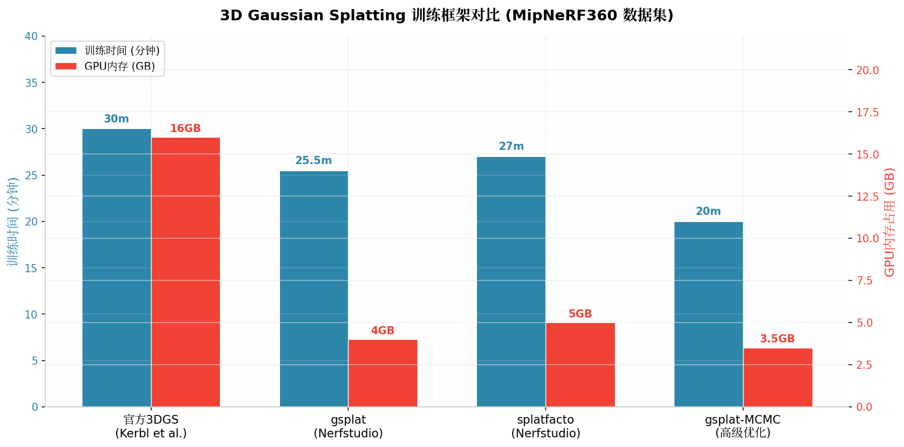
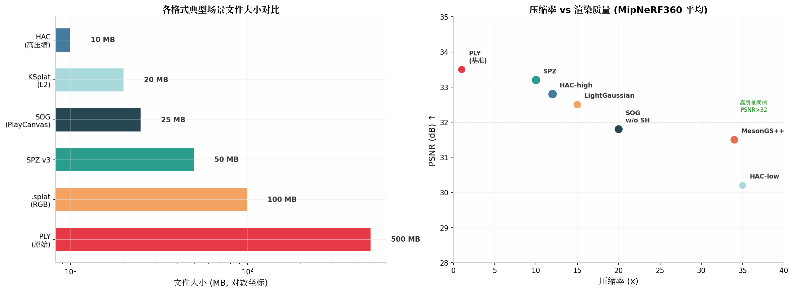
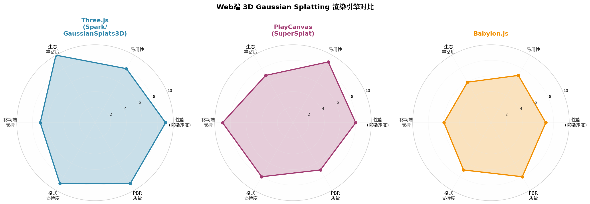
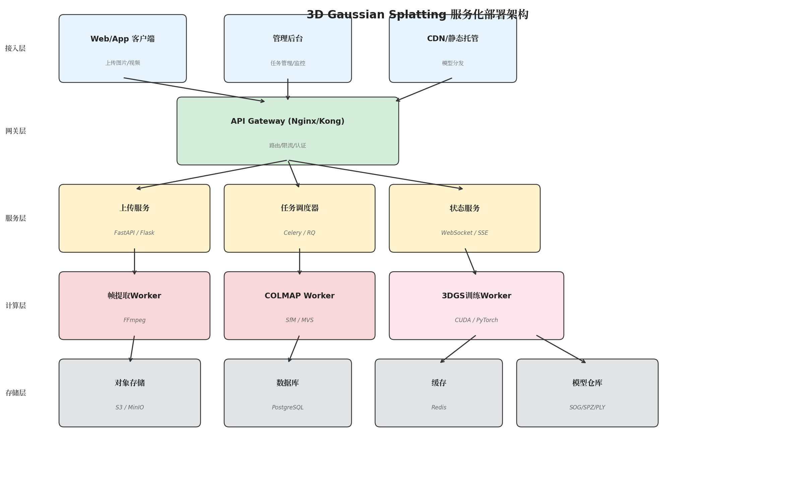
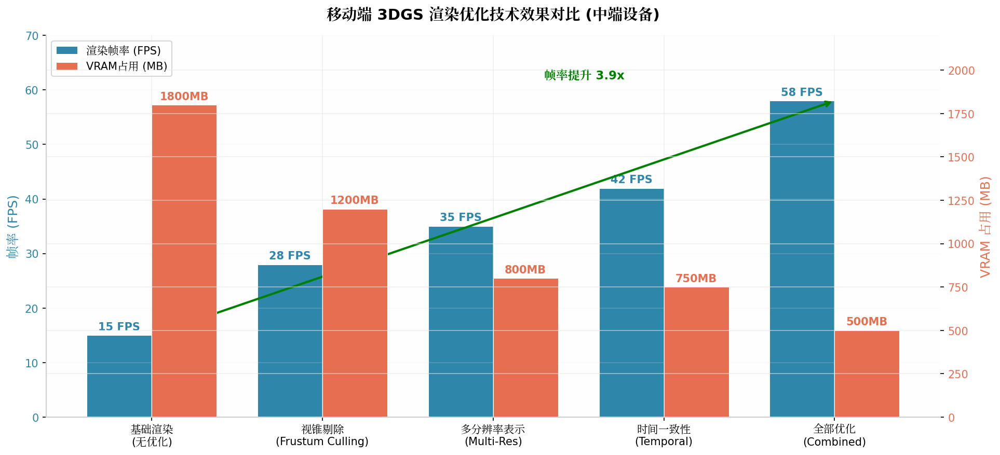

# 3D Gaussian Splatting 工程化实践落地指南

> **版本**: v1.0 | **更新日期**: 2026-06-02 | **目标读者**: 内部技术团队

---

## TL;DR

3D Gaussian Splatting（3DGS）的完整工程化交付链路可概括为一条五步流水线：**用户上传图片/视频** → **FFmpeg帧提取 + COLMAP位姿估计** → **GPU训练（gsplat/splatfacto，约15-30分钟）** → **格式转换压缩（PLY→SOG/SPZ，压缩率10-20x）** → **Web端渲染交付**。核心选型建议：训练侧采用 **Nerfstudio + gsplat**（Docker部署），Web渲染侧采用 **Spark（Three.js）** 或 **SuperSplat（PlayCanvas）** 方案，服务化侧采用 **FastAPI + Celery + GPU Worker** 队列架构。单场景端到端耗时约 **22-50分钟**（RTX 4060级别GPU），压缩后文件体积可控制在 **10-50MB** 以内。

---

## 1. 技术概述与核心原理

### 1.1 什么是 3D Gaussian Splatting

3D Gaussian Splatting（3DGS）是2023年由INRIA和马克斯·普朗克研究所提出的**显式三维场景表示方法**，它将场景建模为数十万到数百万个三维高斯椭球（Gaussian primitives）的集合。每个高斯 primitive 携带位置（XYZ）、协方差（旋转+缩放）、颜色（球谐函数SH系数）和不透明度四个属性。与传统的NeRF（神经辐射场）方法相比，3DGS 最大的优势在于其**显式表示**带来的渲染效率——通过定制化的CUDA光栅化管线，可在消费级GPU上实现 **100+ FPS 的实时渲染**  [(maverickframe.com)](https://maverickframe.com/blog/gaussian-splatting/) 。

从工程实践的角度理解，3DGS 本质上是一种**"从图像到可渲染点云"**的重建技术。它首先通过 Structure-from-Motion（SfM）从多视角图像中恢复相机位姿和稀疏点云，然后将每个点初始化为一个3D高斯，最后通过可微光栅化进行迭代优化，直到渲染图像与输入图像的差异最小化。这一显式表示特性使得 3DGS 在**可编辑性、跨平台部署和调试便利性**方面显著优于隐式的NeRF方法  [(thefuture3d.com)](https://www.thefuture3d.com/software/nerfstudio/) 。

### 1.2 工程化交付的核心挑战

将 3DGS 从研究原型转化为可交付的生产系统，需要跨越多个工程鸿沟。首先是**训练环境的重型依赖**——CUDA、PyTorch、COLMAP等组件的版本兼容性 notoriously 脆弱，不同GPU架构（Ampere vs Ada Lovelace）的编译选项差异常常导致运行时错误  [(Github)](https://github.com/graphdeco-inria/gaussian-splatting/issues/334) 。其次是**数据格式的碎片化**——从训练输出的PLY（数百MB）到Web可加载的SOG/SPZ（数十MB），需要经过复杂的格式转换和压缩流程  [(PlayCanvas)](https://developer.playcanvas.com/user-manual/gaussian-splatting/formats/) 。第三是**Web端渲染的性能门槛**——数百万高斯 primitive 的实时排序和混合在移动端浏览器上仍是重大挑战  [(App Design Updates)](https://appdesign.intelligent-ps.store/blog/gaussian-splatting-mobile-ecommerce) 。最后是**服务化架构的设计**——3DGS训练是长时间的GPU密集型任务，需要与Web服务的请求-响应模型解耦，通过异步队列实现合理的资源调度  [(Github)](https://github.com/Hexinator12/Project-Mirror-The-Hyper-Local-Digital-Twin-Vault/blob/main/DEVELOPMENT_GUIDE.md) 。

| 挑战维度 | 具体问题 | 工程影响 |
|---------|---------|---------|
| **环境依赖** | CUDA/PyTorch/COLMAP版本冲突，GPU驱动兼容性  [(Github)](https://github.com/graphdeco-inria/gaussian-splatting/issues/334)  | 部署失败、运行时崩溃 |
| **数据格式** | PLY体积过大（500MB+），Web加载不可行  [(arXiv.org)](https://arxiv.org/html/2407.09510v4)  | 用户等待时间长、流量成本高 |
| **Web渲染** | 移动端FPS低、内存溢出、排序延迟  [(App Design Updates)](https://appdesign.intelligent-ps.store/blog/gaussian-splatting-mobile-ecommerce)  | 用户体验差、设备兼容性差 |
| **服务架构** | GPU训练耗时15-30分钟，阻塞HTTP请求不可行  [(Github)](https://github.com/Hexinator12/Project-Mirror-The-Hyper-Local-Digital-Twin-Vault/blob/main/DEVELOPMENT_GUIDE.md)  | 需要异步任务队列和状态管理 |
| **质量可控** | 训练参数敏感，不同场景收敛差异大  [(MDPI)](https://www.mdpi.com/2220-9964/14/1/21)  | 输出质量不稳定，需要监控和回退机制 |

### 1.3 完整交付链路概览

一条生产级的 3DGS 交付链路包含五个主要阶段，每个阶段都有明确的输入输出和可选的工具链。下图展示了从用户上传到最终Web渲染的完整数据流：

```
┌─────────────┐    ┌──────────────┐    ┌─────────────┐    ┌──────────────┐    ┌─────────────┐
│ 用户上传    │ → │ 数据预处理   │ → │  3DGS训练   │ → │ 格式转换压缩 │ → │ Web端渲染   │
│图片/视频    │    │帧提取+SfM    │    │ GPU优化     │    │ PLY→SOG/SPZ │    │ 浏览器展示  │
└─────────────┘    └──────────────┘    └─────────────┘    └──────────────┘    └─────────────┘
     2-5MB            5-30分钟            15-30分钟            2-5分钟             <3秒加载
```

在实际项目中，第一阶段（用户上传）和最后阶段（Web渲染）由前端服务处理，中间三个阶段通常在独立的GPU工作节点上异步执行。这种**异步流水线设计**是服务化架构的核心原则——用户上传后获得一个任务ID，通过轮询或WebSocket获取进度更新，训练完成后通过CDN加载渲染结果  [(Github)](https://github.com/Hexinator12/Project-Mirror-The-Hyper-Local-Digital-Twin-Vault/blob/main/DEVELOPMENT_GUIDE.md) 。

---

## 2. 环境搭建与容器化部署

### 2.1 基础依赖栈

3DGS 的训练环境依赖一条相对固定的软件栈，从底层向上依次为 NVIDIA 驱动 → CUDA Toolkit → PyTorch → COLMAP → 训练框架。每一层的版本选择都会影响上层组件的兼容性，因此在生产环境中强烈建议使用**容器化部署**来锁定依赖版本  [(Aegean AI Inc.Aegean AI Inc.)](https://aegean.ai/aiml-common/projects/robotics/gaussian-splatting) 。

| 依赖层 | 推荐版本 | 作用说明 | 版本约束 |
|--------|---------|---------|---------|
| NVIDIA Driver | ≥525.60 | GPU驱动基础 | 需支持CUDA 11.8+ |
| CUDA Toolkit | 11.8 或 12.1 | GPU并行计算 | PyTorch需对应版本  [(Aegean AI Inc.Aegean AI Inc.)](https://aegean.ai/aiml-common/projects/robotics/gaussian-splatting)  |
| PyTorch | 2.1.2+ (cu118/cu121) | 深度学习框架 | 必须与CUDA版本匹配 |
| torchvision | 对应PyTorch版本 | 图像处理 | 与PyTorch一起安装 |
| COLMAP | 3.8+ | SfM/MVS位姿估计 | 推荐从源码编译  [(LearnOpenCV)](https://learnopencv.com/3d-gaussian-splatting/)  |
| gsplat | 1.5.3+ | CUDA光栅化库 | PyPI安装即可  [(gsplat.studio)](https://docs.gsplat.studio/)  |
| Nerfstudio | 1.1.3+ | 训练框架 | 包含gsplat依赖  [(Aegean AI Inc.Aegean AI Inc.)](https://aegean.ai/aiml-common/projects/robotics/gaussian-splatting)  |

### 2.2 Docker 容器化方案

生产环境中最可靠的部署方式是使用官方预构建的 Docker 镜像。**Nerfstudio 官方镜像**已经包含了所有依赖的预配置，支持通过环境变量指定CUDA架构，避免了从源码编译的复杂性  [(Aegean AI Inc.Aegean AI Inc.)](https://aegean.ai/aiml-common/projects/robotics/gaussian-splatting) 。

**方案A：官方镜像（推荐用于快速启动）**

```bash
# 拉取并运行官方镜像
docker run --gpus all \
  -u $(id -u) \
  -v $(pwd)/data/captures:/data/captures \
  -v $(pwd)/data/ns_outputs:/data/ns_outputs \
  -v $HOME/.cache:/home/user/.cache \
  -p 7007:7007 \
  --rm -it \
  --shm-size=12gb \
  ghcr.io/nerfstudio-project/nerfstudio:latest
```

**方案B：自定义构建（推荐用于生产环境）**

自定义 Dockerfile 允许锁定具体版本并预装业务所需的额外依赖。以下是一个生产级 Dockerfile 的核心结构：

```dockerfile
FROM nvidia/cuda:11.8.0-cudnn8-devel-ubuntu22.04

# 安装系统依赖
RUN apt-get update && apt-get install -y \
    python3.10 python3-pip git wget \
    colmap libceres-dev libboost-all-dev \
    ffmpeg libsm6 libxext6 \
    && rm -rf /var/lib/apt/lists/*

# 安装PyTorch (CUDA 11.8)
RUN pip install torch==2.1.2 torchvision==0.16.2 \
    --index-url https://download.pytorch.org/whl/cu118

# 安装gsplat和Nerfstudio
RUN pip install gsplat==1.5.3 nerfstudio==1.1.3

# 安装业务依赖
RUN pip install fastapi celery redis sqlalchemy boto3

WORKDIR /app
COPY . /app
```

**docker-compose.yml 配置（GPU支持）**

```yaml
version: '3.8'
services:
  gsplat-worker:
    build: .
    runtime: nvidia
    environment:
      - NVIDIA_VISIBLE_DEVICES=all
      - CUDA_VISIBLE_DEVICES=0
    volumes:
      - ./data:/app/data
      - ./models:/app/models
    deploy:
      resources:
        reservations:
          devices:
            - capabilities: [gpu]
    shm_size: '12gb'
```

部署时务必确保宿主机已正确安装 **NVIDIA Container Toolkit**，这是Docker容器访问GPU的桥梁  [(python | DeepWiki)](https://deepwiki.com/hbb1/torch-splatting/4.2-docker-configuration) 。验证命令为 `docker run --rm --gpus all nvidia/cuda:11.8.0-base-ubuntu22.04 nvidia-smi`，如果正常输出GPU信息则说明配置成功。

### 2.3 原生环境搭建（开发调试用）

开发调试阶段可能需要原生环境以获得更快的代码迭代速度。推荐使用 conda 创建隔离环境：

```bash
# 创建conda环境
conda create -n gaussian-splatting python=3.10 -y
conda activate gaussian-splatting

# 安装PyTorch (根据CUDA版本选择)
# CUDA 11.8:
pip install torch==2.1.2 torchvision==0.16.2 --index-url https://download.pytorch.org/whl/cu118
# CUDA 12.1:
pip install torch==2.1.2 torchvision==0.16.2 --index-url https://download.pytorch.org/whl/cu121

# 安装COLMAP (Ubuntu)
sudo apt install colmap

# 安装gsplat和Nerfstudio
pip install gsplat nerfstudio

# 验证安装
ns-train --help
gsplat --help
```

环境搭建是项目启动阶段最容易踩坑的环节。常见的问题包括：CUDA版本与PyTorch不匹配、COLMAP编译失败（缺少依赖库）、gsplat的CUDA扩展编译超时等。建议团队维护一个**预配置好的Docker镜像**作为唯一可信的部署基线，所有生产环境必须基于该镜像运行。

---

## 3. 输入数据处理 Pipeline

### 3.1 视频输入处理流程

用户上传视频是目前最常见的输入形式。视频处理的完整 pipeline 包含三个串行步骤：**帧提取** → **质量筛选** → **COLMAP位姿估计**。每个步骤都有明确的工程参数和可预期的耗时  [(LearnOpenCV)](https://learnopencv.com/3d-gaussian-splatting/) 。



**步骤一：FFmpeg帧提取**

帧提取的核心参数是**采样率（FPS）**。过高的采样率会导致相邻帧重叠度过高，增加COLMAP处理时间而不提升重建质量；过低的采样率则可能丢失关键视角信息。根据社区实践经验，**2-10 FPS**是大多数场景的最佳选择  [(maverickframe.com)](https://maverickframe.com/blog/gaussian-splatting/) 。

```bash
# 基础帧提取 (2 FPS)
ffmpeg -i input.mp4 -vf "fps=2,scale='min(1920,iw)':-1" frames/frame_%04d.jpg

# 高质量模式 (保留更多帧用于复杂场景)
ffmpeg -i input.mp4 -vf "fps=10,scale=1920:-1" -q:v 2 frames/frame_%04d.jpg

# 关键帧提取 (减少冗余)
ffmpeg -i input.mp4 -vf "select='eq(pict_type,I)',scale=1920:-1" -vsync vfr frames/keyframe_%04d.jpg
```

| 参数 | 推荐值 | 说明 |
|------|--------|------|
| 采样FPS | 2-5 (简单场景) / 5-10 (复杂场景) | 慢速移动选低FPS，快速环绕选高FPS  [(maverickframe.com)](https://maverickframe.com/blog/gaussian-splatting/)  |
| 输出分辨率 | 1920px宽度（保持宽高比） | 超过1.6K会被训练脚本自动降采样  [(Github)](https://github.com/graphdeco-inria/gaussian-splatting)  |
| 图像质量 | -q:v 2 (JPEG高质量) | 避免压缩伪影影响COLMAP特征匹配 |
| 输出格式 | JPG (推荐) / PNG | JPG体积更小，PNG无损但占用空间大 |

**步骤二：COLMAP Structure-from-Motion**

COLMAP是3DGS pipeline中最容易成为瓶颈的环节。对于包含200-500张图像的典型场景，COLMAP的**特征提取+匹配+重建**流程可能需要 **5-15分钟**  [(Github)](https://github.com/Hexinator12/Project-Mirror-The-Hyper-Local-Digital-Twin-Vault/blob/main/DEVELOPMENT_GUIDE.md) 。在大规模部署中，建议将COLMAP运行在独立的CPU工作节点上，与GPU训练节点解耦。

```bash
# COLMAP完整SfM流程
colmap feature_extractor \
  --database_path $PROJECT_DIR/database.db \
  --image_path $PROJECT_DIR/images \
  --ImageReader.camera_model PINHOLE \
  --ImageReader.single_camera 1

colmap exhaustive_matcher \
  --database_path $PROJECT_DIR/database.db

colmap mapper \
  --database_path $PROJECT_DIR/database.db \
  --image_path $PROJECT_DIR/images \
  --output_path $PROJECT_DIR/sparse

# 导出为文本格式 (供训练使用)
colmap model_converter \
  --input_path $PROJECT_DIR/sparse/0 \
  --output_path $PROJECT_DIR/sparse \
  --output_type TXT
```

COLMAP处理完成后，会在 `sparse/` 目录下生成三个核心文件：`cameras.txt`（相机内参）、`images.txt`（相机外参/位姿）、`points3D.txt`（稀疏点云）。这三个文件加上原始图像目录，构成了3DGS训练所需的完整输入  [(LearnOpenCV)](https://learnopencv.com/3d-gaussian-splatting/) 。

### 3.2 图片输入处理流程

如果用户直接上传图片集（而非视频），处理流程会省略帧提取步骤，但需要额外关注**图像命名顺序**和**EXIF元数据**。COLMAP通过文件名排序来确定处理顺序，建议在上传时要求用户按拍摄顺序命名（如 `001.jpg`, `002.jpg` ...），或在服务端根据EXIF时间戳自动重命名。

```python
# 图片集自动排序（基于EXIF时间戳）
from PIL import Image
from PIL.ExifTags import TAGS
import os

def sort_images_by_exif(image_dir):
    images = []
    for f in os.listdir(image_dir):
        if f.lower().endswith(('.jpg', '.jpeg', '.png')):
            path = os.path.join(image_dir, f)
            img = Image.open(path)
            exif = img._getexif()
            timestamp = exif.get(36867, '') if exif else ''  # DateTimeOriginal
            images.append((timestamp, f))
    
    images.sort()
    # 重命名为有序文件名
    for i, (_, old_name) in enumerate(images):
        ext = os.path.splitext(old_name)[1]
        new_name = f"frame_{i:04d}{ext}"
        os.rename(os.path.join(image_dir, old_name), 
                  os.path.join(image_dir, new_name))
```

### 3.3 输入质量检查与预处理

在将数据送入COLMAP之前，建议进行以下**自动化质量检查**：

| 检查项 | 阈值 | 处理策略 |
|--------|------|---------|
| 最小图像数量 | ≥30张 | 不足时提示用户补充拍摄  [(maverickframe.com)](https://maverickframe.com/blog/gaussian-splatting/)  |
| 图像模糊度 | Laplacian方差 > 100 | 过滤运动模糊帧  [(arXiv.org)](https://arxiv.org/html/2504.15122v3)  |
| 图像尺寸一致性 | 宽高比差异 < 5% | 异常尺寸触发警告 |
| 重复帧检测 | SSIM > 0.95 | 去重减少COLMAP负担 |
| 存储空间预估 | 预留3x原始体积 | 帧提取和COLMAP中间文件占用大 |

运动模糊是视频输入的常见问题，尤其是在用户手持拍摄时。**Laplacian方差检测**是一种快速有效的模糊检测方法：

```python
import cv2
import numpy as np

def detect_blur(image_path, threshold=100):
    """返回图像清晰度评分，低于阈值视为模糊"""
    img = cv2.imread(image_path, cv2.IMREAD_GRAYSCALE)
    laplacian_var = cv2.Laplacian(img, cv2.CV_64F).var()
    return laplacian_var, laplacian_var >= threshold
```

---

## 4. 训练框架选型与对比

### 4.1 主流训练框架概览

当前生产环境中最常用的三个训练框架分别是**官方参考实现**（graphdeco-inria/gaussian-splatting）、**gsplat**（nerfstudio-project/gsplat）和 **splatfacto**（Nerfstudio的内置方法）。这三个框架在API设计、性能表现和生态集成方面各有侧重  [(thefuture3d.com)](https://www.thefuture3d.com/software/nerfstudio/) 。

| 维度 | 官方3DGS | gsplat | splatfacto (Nerfstudio) |
|------|---------|--------|------------------------|
| **定位** | 研究参考实现 | 高性能生产库 | 完整训练管线 |
| **训练时间** | ~30min  [(arXiv.org)](https://arxiv.org/html/2409.06765v1)  | ~25.5min (节省15%)  [(gsplat.studio)](https://docs.gsplat.studio/)  | ~27min  [(thefuture3d.com)](https://www.thefuture3d.com/software/nerfstudio/)  |
| **GPU内存** | ~16GB  [(arXiv.org)](https://arxiv.org/html/2409.06765v1)  | ~4GB (减少4x)  [(gsplat.studio)](https://docs.gsplat.studio/)  | ~5GB |
| **安装难度** | 中等（需编译CUDA扩展） | 简单（pip install） | 简单（pip install） |
| **API设计** | 命令行脚本 | Python库 + CUDA核函数 | 命令行 + Python API |
| **实时监控** | TensorBoard | 支持 | 内置Viewer (port 7007)  [(Aegean AI Inc.Aegean AI Inc.)](https://aegean.ai/aiml-common/projects/robotics/gaussian-splatting)  |
| **多GPU支持** | 有限 | 支持分布式光栅化  [(gsplat.studio)](https://docs.gsplat.studio/)  | 支持 |
| **压缩集成** | 无 | 内置MCMC + 量化  [(arXiv.org)](https://arxiv.org/html/2407.09510v4)  | 通过导出插件 |
| **许可协议** | 自定义（研究用） | Apache 2.0 | Apache 2.0 |


**选型建议**：对于追求**开箱即用**和**生态完整性**的团队，推荐 **Nerfstudio + gsplat** 组合。Nerfstudio提供了统一的训练、评估和导出管线，其内置的Web Viewer（端口7007）允许在训练过程中实时观察收敛效果；gsplat作为底层光栅化库，提供了比官方实现更高效的内存使用和更快的训练速度  [(thefuture3d.com)](https://www.thefuture3d.com/software/nerfstudio/) 。对于需要**深度定制**训练逻辑的场景，可以直接使用 gsplat 的 Python API 构建自定义训练循环。

### 4.2 gsplat 核心优势

gsplat 是目前社区公认的生产级首选库，其性能优势来源于**高度优化的CUDA核函数**和**精心设计的内存管理策略**。根据 JMLR 上发表的论文评估，gsplat在MipNeRF360数据集上实现了与官方实现相同的渲染质量（PSNR），同时将训练内存占用从 **16GB 降低到 4GB**，训练时间缩短约 **10-15%**  [(Aaltodoc)](https://aaltodoc.aalto.fi/items/535d91f9-2595-49a4-bff6-47e1ad0cf9c3) 。

gsplat 1.5.3 版本引入了多项对工程部署至关重要的特性：**批量场景光栅化**（同时渲染多个场景的批量推理）、**多GPU分布式支持**（大规模场景的并行训练）、**深度渲染**（支持导出深度图用于下游应用）以及**N-D特征渲染**（支持语义分割等扩展任务） [(gsplat.studio)](https://docs.gsplat.studio/) 。

```python
# gsplat基础训练循环示例
from gsplat import rasterization
import torch

def train_step(viewpoint_cam, gaussians, optimizer):
    # 光栅化渲染
    render_colors, render_alphas, info = rasterization(
        means=gaussians.xyz,           # [N, 3]
        quats=gaussians.rotation,      # [N, 4] 旋转四元数
        scales=gaussians.scaling,      # [N, 3]
        opacities=gaussians.opacity,   # [N, 1]
        colors=gaussians.sh_coeffs,    # [N, K, 3] 球谐系数
        viewmats=viewpoint_cam.world_view_transform,  # [4, 4]
        K=viewpoint_cam.projection_matrix,            # [3, 3]
        width=viewpoint_cam.image_width,
        height=viewpoint_cam.image_height,
        sh_degree=3,
    )
    
    # 计算损失并反向传播
    gt_image = viewpoint_cam.original_image
    loss = l1_loss(render_colors, gt_image) + (1 - ssim(render_colors, gt_image))
    loss.backward()
    optimizer.step()
    
    return loss.item()
```

### 4.3 训练参数调优

3DGS训练的质量和速度对超参数非常敏感。在实际部署中，需要针对不同类型的场景调整关键参数  [(Github)](https://github.com/graphdeco-inria/gaussian-splatting) 。

| 参数 | 默认值 | 推荐范围 | 调整策略 |
|------|--------|---------|---------|
| `iterations` | 30000 | 20000-40000 | 简单场景可减少，复杂场景需增加  [(MDPI)](https://www.mdpi.com/2220-9964/14/1/21)  |
| `resolution` | -1 (自动1.6K) | 512-1920 | 高分辨率提升质量但增加训练时间 |
| `sh_degree` | 3 | 1-3 | VRAM受限时降至1，追求质量保持3  [(Zenn)](https://zenn.dev/kotohibi/articles/409bc16876b9e0)  |
| `densify_from_iter` | 500 | 500-1000 | 过早densify会导致噪声 |
| `densify_until_iter` | 15000 | 10000-20000 | 与总迭代数联动调整 |
| `opacity_cull_threshold` | 0.005 | 0.003-0.01 | 影响最终primitive数量  [(MDPI)](https://www.mdpi.com/2220-9964/14/1/21)  |

对于**室内场景**（如房间、展厅），建议将 `opacity_cull_threshold` 设为 **0.0003** 并将密度控制超参数设为 **0.001**，这可以显著提升细节重建质量（PSNR提升约4.3%） [(MDPI)](https://www.mdpi.com/2220-9964/14/1/21) 。对于**室外大场景**，则需要启用位置学习率的渐进衰减（`position_lr_init` 和 `position_lr_final`）以获得更好的几何一致性  [(arXiv.org)](https://arxiv.org/html/2605.14629v1) 。

### 4.4 训练加速技术

除了框架层面的优化，还有多种技术可以进一步缩短训练时间。**3DGS-LM** 方法通过Levenberg-Marquardt优化器替代Adam，在保持相同质量的前提下平均加速 **30%**  [(lukashoel.github.io)](https://lukashoel.github.io/3DGS-LM/static/3DGS-LM_paper.pdf) 。**Near Second-order Converging 3DGS** 方法则更为激进，利用局部Newton方法实现了 **5-10倍** 的收敛加速，将训练时间从分钟级压缩到秒级——不过该方法需要更大的GPU内存（约53GB）作为权衡  [(arXiv.org)](https://arxiv.org/html/2501.13975v1) 。

```bash
# Nerfstudio快速训练命令
ns-train splatfacto \
  --data /data/captures/my_scene \
  --output-dir /data/outputs \
  --pipeline.model.sh-degree 3 \
  --pipeline.model.cull-alpha-thresh 0.005 \
  --max-num-iterations 30000 \
  --viewer.websocket-port 7007
```

---

## 5. 数据格式与压缩策略

### 5.1 核心格式对比

3DGS生态中存在多种文件格式，每种格式在**体积、质量、加载速度**之间做出了不同的权衡。理解这些差异对于制定合理的交付策略至关重要  [(PlayCanvas)](https://developer.playcanvas.com/user-manual/gaussian-splatting/formats/) 。



| 格式 | 扩展名 | SH支持 | 典型大小 | 压缩率 | 适用场景 |
|------|--------|--------|---------|--------|---------|
| **PLY** | .ply | 完整(SH0-3) | 200-500MB | 1x (基准) | 训练/编辑/归档  [(PlayCanvas)](https://developer.playcanvas.com/user-manual/gaussian-splatting/formats/)  |
| **SPLAT** | .splat | 无(RGB only) | 50-150MB | ~5x | 旧版Web兼容  [(Github)](https://github.com/francescofugazzi/3dgsconverter)  |
| **SPZ v3** | .spz | 完整(SH0-3) | 20-50MB | ~10x | 通用Web交付  [(Github)](https://github.com/unitycoder/spz-splat-format)  |
| **SPZ v4** | .spz | SH0-4 | 20-50MB | ~10x | 高级Web交付  [(Github)](https://github.com/francescofugazzi/3dgsconverter)  |
| **SOG** | .sog | 完整(SH0-3) | 10-30MB | ~20x | 移动端/Web优先  [(PlayCanvas)](https://developer.playcanvas.com/user-manual/gaussian-splatting/formats/)  |
| **KSplat** | .ksplat | SH0-2 | 15-40MB | ~15x | 流式加载  [(Github)](https://github.com/francescofugazzi/3dgsconverter)  |

**PLY** 是训练框架的原生输出格式，采用全精度float32存储所有属性，体积庞大但**无损**。它是编辑和归档的首选格式，但不适合直接用于Web交付  [(PlayCanvas)](https://developer.playcanvas.com/user-manual/gaussian-splatting/formats/) 。**SPZ**（由Niantic开源）通过量化和gzip压缩实现了约10倍的体积缩减，同时保留了完整的球谐系数（SH0-3），是目前**最均衡的Web交付格式**  [(Github)](https://github.com/unitycoder/spz-splat-format) 。**SOG**（PlayCanvas的Streamed Optimized Gaussian格式）通过将高斯参数组织为2D网格并利用GPU纹理压缩，实现了 **15-20倍** 的压缩率，特别适合大规模场景（10M+高斯）的渐进式加载  [(PlayCanvas)](https://developer.playcanvas.com/user-manual/gaussian-splatting/formats/) 。

### 5.2 压缩技术详解

3DGS的压缩技术可分为**剪枝（Compaction）**和**量化压缩（Compression）**两大类，实际部署中通常组合使用  [(arXiv.org)](https://arxiv.org/html/2407.09510v4) 。

**剪枝技术**通过移除冗余的高斯primitive来减少总数。最有效的策略包括：

- **不透明度剪枝**：移除opacity < 0.005 的primitive（简单但有效）
- **冗余评分剪枝**（Reduced3DGS）：计算每个primitive的冗余度，移除与其他primitive高度重叠的低贡献primitive，可削减约 **60%** 的primitive数量  [(inria.fr)](https://repo-sam.inria.fr/fungraph/reduced_3dgs/reduced_3DGS_i3d.pdf) 
- **重要性评分剪枝**（LightGaussian）：基于全局渲染贡献计算importance score，可削减 **50-70%**  [(arXiv.org)](https://arxiv.org/html/2407.09510v2) 

**量化压缩技术**通过降低属性精度来减少存储：

- **球谐系数量化**：SH系数占总存储的约80%，从float32量化为8bit整数可实现4x压缩而质量损失极小  [(arXiv.org)](https://arxiv.org/html/2407.09510v5) 
- **属性范围裁剪**：基于百分位数裁剪RGB、opacity、SH的范围，然后进行均匀量化  [(arXiv.org)](https://arxiv.org/html/2407.09510v4) 
- **矢量量化**（HAC/CompGS）：使用K-means聚类创建共享码本，将每个primitive的属性映射到码本索引  [(arXiv.org)](https://arxiv.org/html/2407.09510v4) 

```bash
# 使用3dgsconverter进行格式转换和压缩
# PLY → SOG (高质量Web格式)
3dgsconverter input.ply output.sog --format sog --compression_level 5

# PLY → SPZ (通用压缩格式)
3dgsconverter input.ply output.spz --format spz --spz_version 3

# PLY → KSplat (流式格式)
3dgsconverter input.ply output.ksplat --format ksplat --compression_level 2
```

### 5.3 生产环境格式策略

在实际项目中，建议采用**多格式存储策略**：训练输出保留原始PLY作为"母版"，同时生成SPZ和SOG两个压缩版本用于不同场景。

| 存储层级 | 格式 | 用途 | 生命周期 |
|---------|------|------|---------|
| 母版存档 | PLY | 重新训练/编辑/备份 | 永久保留 |
| 标准Web交付 | SPZ | 桌面浏览器渲染 | 与项目同生命周期 |
| 移动端交付 | SOG | 手机/平板渲染 | 与项目同生命周期 |
| 快速预览 | SOG (低质量) | 首屏快速加载 | 生成后缓存 |

对于带宽敏感的场景（如移动端网络），可以进一步实现**渐进式加载**——先加载SOG的基底层获得快速预览，再按需加载增强层提升细节  [(thefuture3d.com)](https://www.thefuture3d.com/software/supersplat/) 。SuperSplat的SOG格式原生支持这种LOD流式加载，其原理与3DTiles的点云流式类似  [(PlayCanvas)](https://developer.playcanvas.com/user-manual/gaussian-splatting/formats/) 。

---

## 6. Web端渲染引擎选型

### 6.1 渲染引擎全景

Web端3DGS渲染引擎的选择直接影响最终用户的体验质量。当前生态中，基于 **Three.js** 和 **PlayCanvas** 的方案占据了主流地位，两者在架构理念和适用场景上有明显差异  [(utsubo.com)](https://www.utsubo.com/blog/threejs-vs-babylonjs-vs-playcanvas-comparison) 。



| 引擎 | 底层API | 包体积 | 排序实现 | SH支持 | 格式支持 | 适用场景 |
|------|---------|--------|---------|--------|---------|---------|
| **Spark** (Three.js) | WebGL2/WebGPU | ~168KB + three.js | CPU (WASM) / GPU | 完整 | PLY, SPZ, SOG, KSplat  [(Github)](https://github.com/sparkjsdev/spark)  | 生产级Web应用 |
| **GaussianSplats3D** | WebGL2 | ~200KB + three.js | CPU (WASM) | 完整 | PLY, KSplat  [(Github)](https://github.com/mkkellogg/GaussianSplats3D)  | Three.js生态项目 |
| **SuperSplat** (PlayCanvas) | WebGL2 | ~300KB | GPU | 完整 | PLY, SOG, SPLAT  [(The Menon Lab)](https://themenonlab.blog/blog/supersplat-gaussian-splatting-3d-photos-open-source)  | 编辑器/快速部署 |
| **antimatter15/splat** | WebGL1 | ~50KB (无依赖) | Web Worker (CPU) | 无(RGB) | SPLAT  [(Github)](https://github.com/FullToker/my_antimatter15_splat)  | 极简原型/教育 |
| **WebSplatter** | WebGPU | ~100KB | GPU Radix Sort | 完整 | PLY, SPZ  [(arXiv.org)](https://arxiv.org/html/2602.03207v1)  | 高性能未来方向 |
| **CesiumJS扩展** | WebGL2 | ~1MB+ | CPU | 部分 | SPLAT  [(threejs3d.com)](https://threejs3d.com/cesium-projects/projects/gaohualan-cesium-splat)  | 地理空间应用 |

### 6.2 引擎深度对比

**Spark（推荐用于生产）**

Spark由World Labs开发，是目前功能最完善的Three.js Gaussian Splatting渲染器。它原生支持 **多splat对象混合渲染**（splat与mesh共存）、**实时编辑**（颜色修改/位移/骨骼动画）以及**shader graph系统**，可以动态在GPU上创建和编辑splat  [(Github)](https://github.com/sparkjsdev/spark) 。Spark支持几乎所有主流格式（包括压缩PLY、SPZ v3/v4、SOG、KSplat），并针对低功耗移动设备进行了渲染优化。

```javascript
// Spark基础使用示例
import { SplatMesh } from '@sparkjsdev/spark';

const splat = new SplatMesh({
    source: 'https://cdn.example.com/model.spz',
    format: 'spz'
});
scene.add(splat);

// 实时颜色编辑
splat.setColorTint(new THREE.Color(1.0, 0.8, 0.6));
```

**SuperSplat（推荐用于编辑器场景）**

SuperSplat是PlayCanvas团队开源的浏览器端编辑器，支持拖放加载、artifact清理、裁剪、注释/热点添加、后处理效果（bloom/sharpen/color grading）以及一键发布到URL  [(The Menon Lab)](https://themenonlab.blog/blog/supersplat-gaussian-splatting-3d-photos-open-source) 。其最大的工程价值在于**SOG格式的流式LOD支持**——可处理1000万+高斯的超大规模场景，并实现设备感知的渐进加载  [(thefuture3d.com)](https://www.thefuture3d.com/software/supersplat/) 。SuperSplat适合需要给运营/内容团队提供自助编辑工具的场景。

**antimatter15/splat（极简方案）**

这是最早的WebGL Gaussian Splatting实现，仅50KB且无任何外部依赖。它不支持球谐系数（仅RGB颜色），因此文件体积更小，加载更快。适合快速原型验证或对兼容性要求极高的场景（如需要支持老旧浏览器） [(Github)](https://github.com/FullToker/my_antimatter15_splat) 。

### 6.3 Web渲染性能优化

Web端渲染3DGS时，**排序（sorting）**是最大的性能瓶颈。高斯primitive需要按深度排序以实现正确的alpha混合，而百万级primitive的排序在JavaScript中是计算密集型操作  [(Github)](https://github.com/FullToker/my_antimatter15_splat) 。

| 优化技术 | 实现方式 | 性能增益 | 适用引擎 |
|---------|---------|---------|---------|
| **Web Worker异步排序** | 在独立线程排序不阻塞UI  [(Github)](https://github.com/FullToker/my_antimatter15_splat)  | 避免卡顿 | 所有引擎 |
| **WASM加速排序** | Rust/C++编译为WASM  [(Github)](https://github.com/mkkellogg/GaussianSplats3D)  | 3-5x排序加速 | GaussianSplats3D |
| **GPU Radix Sort** | WebGPU计算着色器  [(arXiv.org)](https://arxiv.org/html/2602.03207v1)  | 10x+排序加速 | WebSplatter |
| **增量排序** | 利用帧间一致性减少重排 | 40-60%开销降低  [(App Design Updates)](https://appdesign.intelligent-ps.store/blog/gaussian-splatting-mobile-ecommerce)  | 自定义实现 |
| **八叉树剔除** | 视锥+遮挡剔除  [(Github)](https://github.com/mkkellogg/GaussianSplats3D)  | 70-90%primitive减少 | GaussianSplats3D |
| **渐进加载** | 按距离优先级加载  [(Github)](https://github.com/FullToker/my_antimatter15_splat)  | 首屏<1秒 | antimatter15/splat |

对于生产部署，推荐采用 **WASM + Web Worker** 的组合方案——这在当前浏览器生态中兼容性最好。WebGPU的GPU排序虽然性能最强，但Safari直到2025年9月才完整支持WebGPU，因此需要保留WebGL2回退路径  [(utsubo.com)](https://www.utsubo.com/blog/threejs-vs-babylonjs-vs-playcanvas-comparison) 。

---

## 7. 服务化部署架构

### 7.1 架构设计原则

3DGS训练是典型的**长时间、高资源占用、异步完成**型任务，与Web服务的同步请求-响应模型天然不匹配。因此，服务化架构的核心原则是**解耦**——将用户交互（上传/查询）与重计算（训练/渲染）分离，通过消息队列实现异步协作  [(Github)](https://github.com/Hexinator12/Project-Mirror-The-Hyper-Local-Digital-Twin-Vault/blob/main/DEVELOPMENT_GUIDE.md) 。



一个生产级的3DGS服务化架构包含五个层次：**接入层**（客户端/Web管理后台）、**网关层**（API Gateway）、**服务层**（业务API/任务调度）、**计算层**（GPU/CPU工作节点）和**存储层**（对象存储/数据库/缓存）。每个层次都有明确的职责边界和扩展策略。

### 7.2 核心服务组件

**上传服务（FastAPI/Flask）**

上传服务负责接收用户的图片/视频文件，进行基础校验（格式、大小、分辨率），然后将文件写入对象存储（S3/MinIO），并向任务队列提交处理任务。上传接口需要支持**分片上传**和**断点续传**，以应对大视频文件的网络不稳定性。

```python
from fastapi import FastAPI, UploadFile, File
from celery import Celery
import uuid

app = FastAPI()
celery_app = Celery('gaussian_splatting', broker='redis://redis:6379/0')

@app.post("/api/v1/upload")
async def upload_video(file: UploadFile = File(...)):
    project_id = str(uuid.uuid4())
    
    # 保存到对象存储
    file_path = f"s3://uploads/{project_id}/{file.filename}"
    await save_to_s3(file, file_path)
    
    # 提交异步处理任务
    task = process_gaussian_splatting.delay(project_id, file_path)
    
    return {
        "project_id": project_id,
        "task_id": task.id,
        "status": "queued",
        "estimated_time": "25-45 minutes"
    }

@app.get("/api/v1/status/{project_id}")
async def get_status(project_id: str):
    # 查询任务状态
    status = get_task_status(project_id)
    return status
```

**任务调度器（Celery + Redis）**

Celery负责任务的路由、调度和重试。3DGS pipeline包含三个串行阶段（帧提取 → COLMAP → 训练），需要定义任务依赖关系链：

```python
from celery import chain

@celery_app.task(bind=True, max_retries=3)
def extract_frames(self, project_id, video_path):
    try:
        result = ffmpeg_extract_frames(video_path, fps=5)
        return {"project_id": project_id, "frames_dir": result}
    except Exception as exc:
        raise self.retry(exc=exc, countdown=60)

@celery_app.task(bind=True, max_retries=2)
def run_colmap(self, prev_result):
    frames_dir = prev_result["frames_dir"]
    colmap_output = colmap_sfm(frames_dir)
    return {**prev_result, "colmap_dir": colmap_output}

@celery_app.task(bind=True, time_limit=3600)
def train_gaussian_splatting(self, prev_result):
    colmap_dir = prev_result["colmap_dir"]
    model_path = gsplat_train(colmap_dir, iterations=30000)
    compressed = convert_to_sog(model_path)
    return {**prev_result, "model_url": compressed}

# 定义任务链
def submit_pipeline(project_id, video_path):
    chain(
        extract_frames.s(project_id, video_path),
        run_colmap.s(),
        train_gaussian_splatting.s()
    ).apply_async()
```

**状态服务（WebSocket/SSE）**

用户需要实时了解任务进度。Server-Sent Events（SSE）是实现这一需求的最轻量方案——客户端建立一个持久HTTP连接，服务端在有进度更新时推送数据。

```python
from fastapi import APIRouter
from fastapi.responses import StreamingResponse
import asyncio
import json

router = APIRouter()

@router.get("/api/v1/stream/{project_id}")
async def stream_progress(project_id: str):
    async def event_generator():
        while True:
            status = await get_project_status(project_id)
            yield f"data: {json.dumps(status)}\n\n"
            
            if status["stage"] == "completed":
                break
                
            await asyncio.sleep(2)  # 2秒轮询间隔
    
    return StreamingResponse(
        event_generator(), 
        media_type="text/event-stream"
    )
```

### 7.3 GPU资源管理

GPU是3DGS训练中最昂贵的资源，需要精细的调度和管理策略。

| 策略 | 实现方式 | 效果 |
|------|---------|------|
| **独占模式** | 每个Worker绑定一个GPU | 最稳定，避免资源争抢 |
| **队列优先级** | 区分普通/加急任务 | VIP用户优先处理 |
| **超时自动释放** | 训练任务1小时上限 | 防止僵尸任务占用GPU |
| **动态扩容** | K8s HPA基于队列长度 | 高峰自动增加GPU节点 |
| **冷热分离** | 训练节点与API节点分离 | API不受训练负载影响 |

在Kubernetes环境中，可以使用 **NVIDIA GPU Operator** 自动管理GPU设备的发现和分配，配合 **Cluster Autoscaler** 实现GPU节点的弹性伸缩。对于成本敏感的场景，也可以考虑使用云服务商的**Spot/Preemptible实例**来运行训练任务——3DGS训练可以从中断处恢复（通过checkpoint机制），非常适合这种低成本计算资源  [(python | DeepWiki)](https://deepwiki.com/hbb1/torch-splatting/4.2-docker-configuration) 。

---

## 8. 移动端部署与优化

### 8.1 移动端渲染挑战

移动端浏览器渲染3DGS面临三重约束：**计算能力有限**（中端手机GPU性能仅为桌面级的10-20%）、**内存预算紧张**（可用VRAM通常 < 2GB）、以及**热管理限制**（持续高负载导致降频）。这些约束要求对3DGS数据进行**激进优化**才能在移动设备上实现可接受的帧率  [(App Design Updates)](https://appdesign.intelligent-ps.store/blog/gaussian-splatting-mobile-ecommerce) 。



### 8.2 移动端优化技术栈

**视锥剔除（Frustum Culling）** 是移动端最有效的优化手段。通过GPU计算着色器评估每个高斯在屏幕空间的投影，只保留与当前视锥相交的primitive，可以将排序负载减少 **70-90%**  [(App Design Updates)](https://appdesign.intelligent-ps.store/blog/gaussian-splatting-mobile-ecommerce) 。实现上，这需要在渲染循环中加入一个compute pass来计算可见性掩码。

**多分辨率表示** 通过创建多个细节层次（LOD）的splat数据，根据设备性能和相机距离动态选择合适的层级。在远处使用低密度的splat表示，近处切换到高密度表示，可以在保持视觉质量的同时显著减少每帧处理的高斯数量  [(App Design Updates)](https://appdesign.intelligent-ps.store/blog/gaussian-splatting-mobile-ecommerce) 。

**时间一致性优化** 利用帧间连续性缓存上一帧的排序结果，仅在相机移动超过阈值时进行增量更新。这一策略对于电商产品展示等场景特别有效——用户通常进行缓慢旋转浏览，相机路径可预测，排序缓存命中率高达 **80%** 以上  [(App Design Updates)](https://appdesign.intelligent-ps.store/blog/gaussian-splatting-mobile-ecommerce) 。

| 优化技术 | 帧率影响 | VRAM影响 | 实现复杂度 | 推荐优先级 |
|---------|---------|---------|-----------|-----------|
| 视锥剔除 | +85% FPS | -30% VRAM | 中等 | ★★★★★ |
| 多分辨率LOD | +40% FPS | -55% VRAM | 高 | ★★★★ |
| 时间一致性 | +20% FPS | 无 | 低 | ★★★★ |
| SH降阶(SH0-1) | +15% FPS | -60% VRAM | 低 | ★★★ |
| 量化加载 | +10% FPS | -50% VRAM | 低 | ★★★★ |

### 8.3 PWA部署方案

将3DGS查看器封装为**渐进式Web应用（PWA）**是移动端交付的最佳实践。PWA允许用户"安装"网页为桌面图标，提供接近原生应用的体验，同时避免了应用商店的审核流程  [(cybergarden.au)](https://cybergarden.au/blog/how-to-build-a-gaussian-splat-viewer-pwa-in-one-day-from-capture-to-deploy) 。

```javascript
// PWA Service Worker 缓存策略
self.addEventListener('fetch', (event) => {
    const url = new URL(event.request.url);
    
    // 3D模型文件: 缓存优先
    if (url.pathname.endsWith('.sog') || url.pathname.endsWith('.spz')) {
        event.respondWith(
            caches.match(event.request).then((response) => {
                return response || fetch(event.request).then((fetchResponse) => {
                    return caches.open('splat-models-v1').then((cache) => {
                        cache.put(event.request, fetchResponse.clone());
                        return fetchResponse;
                    });
                });
            })
        );
    }
});
```

iOS Safari对WebXR AR的支持仍有限（截至2026年初），因此iOS端的AR功能需要通过**Quick Look**（USDZ格式）或**原生应用**方案实现。Android端则可以直接使用Chrome的WebXR实现AR查看  [(cybergarden.au)](https://cybergarden.au/blog/how-to-build-a-gaussian-splat-viewer-pwa-in-one-day-from-capture-to-deploy) 。

---

## 9. 性能监控与运维

### 9.1 训练过程监控

3DGS训练的收敛过程需要通过多维度指标进行监控，以便及时发现问题并干预。

| 监控维度 | 指标 | 健康阈值 | 异常处理 |
|---------|------|---------|---------|
| **收敛质量** | Loss值趋势 | 平稳下降，最终 < 0.05 | 不收敛时调整学习率  [(MDPI)](https://www.mdpi.com/2220-9964/14/1/21)  |
| **渲染质量** | PSNR / SSIM | PSNR > 25, SSIM > 0.85 | 质量不达标时延长训练  [(arXiv.org)](https://arxiv.org/html/2410.23213v1)  |
| **资源使用** | GPU利用率 / 显存 | 利用率 > 80% | 利用率低说明数据加载瓶颈 |
| **训练速度** | iter/sec | Ampere架构 > 10 it/s | 速度骤降检查CUDA错误  [(Github)](https://github.com/graphdeco-inria/gaussian-splatting/issues/334)  |
| **Primitive数量** | 高斯总数 | 通常 10万-500万 | 过多导致显存溢出 |

Nerfstudio内置的TensorBoard集成可以实时查看loss曲线和渲染预览  [(Aegean AI Inc.Aegean AI Inc.)](https://aegean.ai/aiml-common/projects/robotics/gaussian-splatting) 。在生产环境中，建议将这些指标通过Prometheus + Grafana进行统一采集和可视化，并设置告警规则（如训练任务超过1小时未完成、PSNR低于20等）。

### 9.2 常见问题排查

| 问题现象 | 可能原因 | 解决方案 |
|---------|---------|---------|
| CUDA illegal memory access  [(Github)](https://github.com/graphdeco-inria/gaussian-splatting/issues/334)  | 显存溢出/越界访问 | 降低batch size，减少图像分辨率 |
| integer multiplication overflow  [(Github)](https://github.com/graphdeco-inria/gaussian-splatting/issues/24)  | primitive数量超过int32上限 | 启用densify控制，限制最大数量 |
| COLMAP重建失败 | 图像重叠不足/运动模糊 | 提示用户重新拍摄，启用模糊检测 |
| 单通道图像错误  [(Github)](https://github.com/graphdeco-inria/gaussian-splatting/issues/733)  | 输入为灰度图 | 预处理转换为RGB |
| 渲染结果有floaters |  reflective表面/天空 | SuperSplat中手动清理  [(thefuture3d.com)](https://www.thefuture3d.com/blog-0/2026/4/3/gaussian-splatting-virtual-production-workflow/)  |
| 训练loss震荡不收敛 | 学习率过大/数据问题 | 降低position_lr，检查数据完整性 |

### 9.3 自动化测试

建立自动化的回归测试pipeline，覆盖从数据输入到Web渲染的完整链路：

```python
# 端到端测试示例
def test_full_pipeline():
    # 1. 上传测试视频
    project_id = upload_test_video("test_data/room_scan.mp4")
    
    # 2. 等待处理完成 (最多60分钟)
    status = wait_for_completion(project_id, timeout=3600)
    assert status["stage"] == "completed"
    
    # 3. 验证输出文件
    assert file_exists(f"s3://models/{project_id}/model.sog")
    assert file_size(f"s3://models/{project_id}/model.sog") < 50_000_000  # <50MB
    
    # 4. 验证渲染质量
    psnr = evaluate_rendering_quality(project_id)
    assert psnr > 25.0
    
    # 5. 验证Web端可加载
    assert web_viewer_loads(f"https://viewer.example.com/{project_id}")
```

---

## 10. 最佳实践与选型决策树

### 10.1 技术选型速查表

以下汇总了工程化部署中的关键选型决策：

| 决策点 | 推荐方案 | 备选方案 | 不推荐 |
|--------|---------|---------|--------|
| **训练框架** | gsplat 1.5.3 + Nerfstudio | 官方3DGS | 自研训练器 |
| **部署方式** | Docker + NVIDIA Container Toolkit | conda原生 | 裸机手动安装 |
| **Web渲染** | Spark (Three.js) | SuperSplat (PlayCanvas) | 自研渲染器 |
| **交付格式** | SPZ (桌面) + SOG (移动) | KSplat | 原始PLY |
| **服务框架** | FastAPI + Celery + Redis | Node.js + Bull Queue | 同步HTTP处理 |
| **对象存储** | MinIO (私有) / S3 (公有) | Ceph | 本地文件系统 |
| **GPU调度** | K8s + GPU Operator | Docker Compose | 手动管理 |
| **监控** | Prometheus + Grafana | Datadog | 无监控 |

### 10.2 部署决策树

```
开始部署规划
    │
    ├─ 是否有NVIDIA GPU服务器?
    │   ├─ 是 → 使用Docker + NVIDIA Container Toolkit
    │   └─ 否 → 考虑云服务GPU实例 (AWS/GCP/阿里云)
    │
    ├─ 预期并发训练任务数?
    │   ├─ ≤2 → Docker Compose单机部署
    │   └─ >2 → Kubernetes集群 + GPU调度
    │
    ├─ 目标用户设备?
    │   ├─ 桌面为主 → SPZ格式 + Spark渲染
    │   ├─ 移动为主 → SOG格式 + PlayCanvas
    │   └─ 全平台 → 双格式 + 自适应加载
    │
    └─ 是否需要自助编辑工具?
        ├─ 是 → 部署SuperSplat实例
        └─ 否 → 仅部署渲染Viewer
```

### 10.3 性能基准参考

基于RTX 4060 (8GB) + Ryzen 7 7700X 的实测数据  [(Github)](https://github.com/Hexinator12/Project-Mirror-The-Hyper-Local-Digital-Twin-Vault/blob/main/DEVELOPMENT_GUIDE.md) ：

| 场景类型 | 视频长度 | 帧提取 | COLMAP | 训练 | 压缩 | 端到端总耗时 |
|---------|---------|--------|--------|------|------|-------------|
| 小房间 (卧室) | 45-60秒 | 2-3分钟 | 5-8分钟 | 15-20分钟 | 2分钟 | **22-31分钟** |
| 中等房间 (展厅) | 60-90秒 | 3-4分钟 | 8-12分钟 | 20-25分钟 | 3分钟 | **31-41分钟** |
| 大空间 (场馆) | 90-120秒 | 4-5分钟 | 12-15分钟 | 25-30分钟 | 4分钟 | **41-50分钟** |

升级到RTX 4090 (24GB)可将训练时间缩短约 **40%**，同时支持更高分辨率（2K+）的训练。

### 10.4 团队技能要求

| 角色 | 核心技能 | 学习周期 |
|------|---------|---------|
| **3DGS训练工程师** | CUDA/PyTorch/COLMAP/Docker | 2-4周 |
| **后端开发** | FastAPI/Celery/对象存储/K8s | 1-2周 |
| **前端/WebGL开发** | Three.js/WebGL/性能优化 | 2-3周 |
| **运维工程师** | NVIDIA Container Toolkit/GPU监控 | 1周 |

---

## 11. 总结与未来趋势

### 11.1 工程化落地的核心要点

3D Gaussian Splatting 从研究原型走向生产交付，关键在于**容器化锁定依赖**、**异步流水线解耦计算**、**多格式适配不同终端**以及**渐进式优化保障体验**四个支柱。Docker + NVIDIA Container Toolkit 解决了环境一致性问题；FastAPI + Celery + GPU Worker 的架构模式解决了训练异步化问题；SPZ/SOG 多格式策略解决了跨终端交付问题；视锥剔除 + LOD + 时间一致性 的组合解决了移动端性能问题。

### 11.2 值得关注的演进方向

- **WebGPU普及**：2025年9月Safari 26完整支持WebGPU后，基于GPU radix sort的渲染器（如WebSplatter）将成为主流，渲染性能有望提升 **5-10倍**  [(utsubo.com)](https://www.utsubo.com/blog/threejs-vs-babylonjs-vs-playcanvas-comparison) 
- **实时训练**：Near Second-order Converging 3DGS 等方法将训练时间压缩到秒级，未来可能实现"边拍边重建"的实时体验  [(arXiv.org)](https://arxiv.org/html/2501.13975v1) 
- **MPEG标准化**：I-3DGS（Immersive 3D Gaussian Splatting）标准正在制定中，将统一编码格式和传输协议  [(arXiv.org)](https://arxiv.org/html/2603.21933v1) 
- **云原生工具链**：DJI Terra、PIX4Dcloud 等商业平台正在将3DGS集成到完整的云端摄影测量管线中  [(thefuture3d.com)](https://www.thefuture3d.com/blog-0/2026/4/3/gaussian-splatting-virtual-production-workflow/) 

---

*本文档基于截至2026年6月的开源生态现状编写，技术选型建议可能随社区发展而变化。建议团队定期关注 gsplat、Nerfstudio 和 SuperSplat 的官方更新。*
