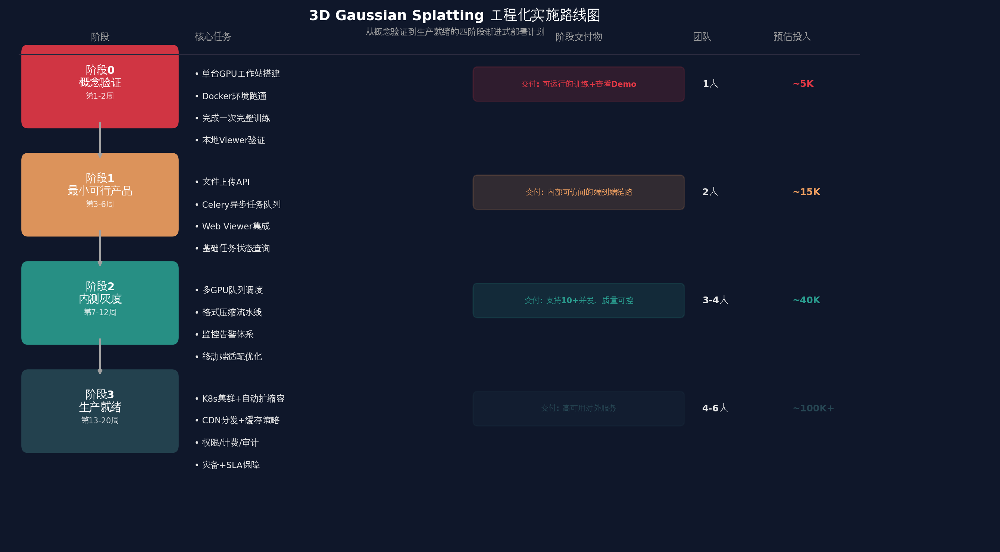
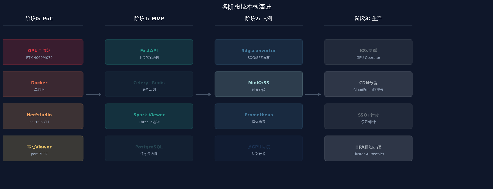

# 3D Gaussian Splatting 工程化实施路线图

> **文档性质**: 项目落地执行计划 | **版本**: v1.0 | **更新日期**: 2026-06-02 | **目标读者**: 技术团队负责人、项目经理

---

## TL;DR

本路线图将3DGS工程化部署划分为**四个递进阶段**，总周期约 **20周（5个月）**：

| 阶段 | 周期 | 核心目标 | 投入（人力+硬件） |
|------|------|---------|----------------|
| **阶段0: 概念验证** | 第1-2周 | 跑通完整训练链路，验证技术可行性 | 1人 + RTX 4060（~5K） |
| **阶段1: 最小可行产品** | 第3-6周 | 端到端可运行的内部服务 | 2人 + 单GPU服务器（~15K） |
| **阶段2: 内测灰度** | 第7-12周 | 多并发支持，质量可控，监控完备 | 3-4人 + 多GPU集群（~40K） |
| **阶段3: 生产就绪** | 第13-20周 | 高可用、可扩展、对外交付 | 4-6人 + K8s集群（~100K+） |

**关键决策点**：阶段0结束时必须评估**渲染质量是否满足业务需求**；阶段1结束时必须确认**单链路稳定性**；阶段2结束时必须验证**并发处理能力**。任一节点不达标，都需要暂停进入下一阶段，先解决当前阶段问题。

---

## 路线图总览



上图展示了从概念验证到生产就绪的完整四阶段路径。每个阶段都有明确的交付物、团队规模和预估投入。下方则是各阶段所引入的技术组件演进全景。



---

## 实施原则

在展开具体阶段之前，先明确贯穿整个实施过程的五项核心原则。这些原则是决定项目成败的底层约束，所有阶段的具体任务都应围绕它们展开。

**渐进式交付，而非大爆炸发布**。3DGS的工程化涉及GPU计算、3D图形、分布式系统等多个复杂域的交叉，任何一步的失误都可能导致整个项目延期。因此，每一阶段的产出都必须是**可独立运行、可验证、可回退**的，而不是等到最后才一次性集成。

**质量门禁优先于速度**。阶段0结束时必须有一个明确的质量门禁——渲染PSNR是否达到业务可接受阈值（通常 > 25dB）。如果训练质量不达标，后续所有工程化工作都将失去意义。同理，阶段1结束时必须验证单条链路的端到端稳定性，阶段2结束时必须验证并发场景下的资源隔离和任务不串扰。

**基础设施即代码，环境即版本**。从阶段0开始，所有环境配置（Dockerfile、docker-compose.yml、conda环境文件）都必须纳入版本控制。不允许存在"只在某台机器上能跑"的配置状态。这条原则在阶段0看似增加 overhead，但在阶段2和阶段3将节省数周的排障时间。

**监控从第一天开始**。即使阶段0只是单机训练，也应当记录每次训练的关键指标（loss曲线、训练时长、GPU利用率、输出模型大小）。这些数据不仅是阶段2搭建正式监控体系的基础，更是团队积累"什么参数组合在什么硬件上跑出什么结果"这一核心知识资产的唯一途径。

**回退路径始终保留**。每个阶段都必须保留一条"降维"路径——阶段1的Web Viewer出问题，可以先用阶段0的本地Viewer兜底；阶段2的压缩流水线出问题，可以先用阶段1的原始PLY文件交付；阶段3的K8s集群出问题，可以先用阶段2的Docker Compose方案应急。

---

## 阶段0: 概念验证（Proof of Concept）

### 阶段目标

阶段0的唯一目标是回答一个根本性问题：**在我们的硬件环境和数据类型上，3DGS能否产出满足业务需求的渲染质量？** 这个阶段不做任何工程化封装，只追求用最短路径跑通一次完整的训练-查看流程，并建立对技术栈各组件的直观理解。

### 时间线：第1-2周

| 周次 | 任务 | 产出 | 验收标准 |
|------|------|------|---------|
| **第1周** | 搭建单GPU工作站（物理机或云实例） | 可运行NVIDIA驱动的Ubuntu 22.04 | `nvidia-smi`正常输出 |
| | 安装Docker + NVIDIA Container Toolkit | Docker可调用GPU | `docker run --gpus all nvidia/cuda:11.8.0-base-ubuntu22.04 nvidia-smi`成功 |
| | 拉取并运行Nerfstudio官方镜像 | 容器内可执行`ns-train` | `ns-train --help`有输出 |
| **第2周** | 使用示例数据集（如bonsai）完成首次训练 | 训练完成的模型文件（PLY） | Viewer中可渲染，无明显artifact |
| | 用团队实际业务场景数据（图片/视频）重复训练 | 业务数据的训练结果 | PSNR > 25dB，主观质量可接受 |
| | 记录训练耗时、GPU利用率、输出文件大小 | 性能基准文档 | 有数据记录，可供后续阶段对比 |

### 硬件需求

| 组件 | 最低配置 | 推荐配置 | 说明 |
|------|---------|---------|------|
| GPU | RTX 3060 12GB | RTX 4070 12GB | 显存 > 8GB 才能训练1.6K分辨率  [(Github)](https://github.com/graphdeco-inria/gaussian-splatting/issues/334)  |
| CPU | 6核12线程 | 8核16线程 | COLMAPSfM阶段CPU密集型 |
| 内存 | 32GB | 64GB | 高分辨率图像COLMAP需要大内存 |
| 存储 | 1TB SSD | 2TB NVMe SSD | 训练中间文件和输出体积大 |
| 网络 | 100Mbps | 1Gbps | 拉取Docker镜像和数据集 |

### 推荐操作路径

**路径A：物理工作站（推荐，成本可控）**

```bash
# 1. 准备Ubuntu 22.04宿主机，安装NVIDIA驱动 525+
# 2. 安装Docker和NVIDIA Container Toolkit
sudo apt-get update
sudo apt-get install -y docker.io
sudo apt-get install -y nvidia-container-toolkit
sudo systemctl restart docker

# 3. 拉取官方镜像并运行
docker run --gpus all -it \
  -p 7007:7007 \
  --shm-size=12gb \
  ghcr.io/nerfstudio-project/nerfstudio:latest

# 4. 容器内下载示例数据并训练
ns-download-data nerfstudio --capture-name=bonsai
ns-train splatfacto --data data/nerfstudio/bonsai \
  --output-dir outputs/ --viewer.websocket-port 7007
```

**路径B：云GPU实例（快速启动，适合无硬件条件）**

| 云服务商 | 推荐实例 | 时价（约） | 2周总成本 |
|---------|---------|-----------|----------|
| AWS | g4dn.xlarge (T4) | ~$0.5/h | ~$170 |
| 阿里云 | gn6i-c4g1.xlarge (T4) | ~¥8/h | ~¥2700 |
| 腾讯云 | GN7.LARGE20 (T4) | ~¥7/h | ~¥2350 |
| Vast.ai | RTX 4090 实例 | ~$0.4/h | ~$135 |

### 阶段交付物

- **可运行的训练Demo**：至少两个场景（示例数据 + 业务数据）的训练结果
- **质量评估报告**：PSNR、SSIM、主观评价、与预期目标的差距分析
- **性能基准数据**：训练时长、GPU利用率峰值、显存占用、输出PLY文件大小
- **环境配置文档**：Dockerfile（或镜像标签）、宿主机配置清单、遇到的问题及解决方案

### 风险与回退

| 风险 | 概率 | 影响 | 应对策略 |
|------|------|------|---------|
| 训练质量不达标 | 中 | 高 | 调整拍摄方式（增加重叠度、避免反光面）、尝试不同sh_degree |
| Docker GPU访问失败 | 中 | 高 | 改用conda原生环境作为fallback |
| 业务数据COLMAP失败 | 高 | 中 | 增加拍摄帧数、避免纯旋转拍摄、尝试sequential_matcher |
| 硬件性能不足 | 低 | 中 | 降级到512分辨率训练、缩短迭代次数至15000 |

### 阶段门禁（Go/No-Go）

**必须通过以下检查才能进入阶段1**：

1. 至少一个业务场景的训练PSNR > 25dB（或达到业务方可接受的主观质量标准）
2. 单次端到端（视频→训练→查看）总耗时 < 60分钟
3. 团队至少有1人能够独立完成从环境搭建到训练查看的完整流程
4. 输出PLY文件可以通过至少一个Web Viewer（本地或在线）正常渲染

---

## 阶段1: 最小可行产品（MVP）

### 阶段目标

阶段1的目标是将阶段0的"手动本地训练"升级为"可通过Web界面访问的端到端服务"。用户能够通过浏览器上传视频/图片，等待一段时间后（异步）查看生成的3D场景。这个阶段不追求高并发、高可用或极致性能，只追求**链路完整、运行稳定、内部可用**。

### 时间线：第3-6周

| 周次 | 任务 | 产出 | 验收标准 |
|------|------|------|---------|
| **第3周** | 搭建FastAPI上传服务 | `/upload`接口可接收文件 | 支持50MB以内文件上传，返回project_id |
| | 集成对象存储（MinIO） | 文件可写入MinIO bucket | 上传文件可在MinIO中查看 |
| | 搭建Celery+Redis任务队列 | Worker可消费任务 | 提交的任务被Worker正确执行 |
| **第4周** | 实现FFmpeg帧提取Worker | 视频自动提取为帧序列 | 2FPS采样，输出JPG到指定目录 |
| | 实现COLMAP Worker | 帧序列生成SfM结果 | 输出cameras.txt/images.txt/points3D.txt |
| | 实现3DGS训练Worker | 可触发gsplat训练 | 训练完成输出PLY到对象存储 |
| **第5周** | 集成Web Viewer（Spark） | 浏览器可查看训练结果 | 加载<5秒，可旋转/缩放浏览 |
| | 实现任务状态查询API | `/status/{project_id}` | 返回当前阶段和进度百分比 |
| | 基础前端页面 | 上传表单+状态显示 | 非技术人员可操作 |
| **第6周** | 端到端联调 | 完整链路跑通 | 视频上传→训练完成→Web查看，全程无人干预 |
| | 内部试用+bug修复 | 稳定版本 | 3个不同场景均成功跑通 |
| | 文档输出 | 部署手册 | 另一团队成员可按文档复现部署 |

### 架构设计（阶段1）

阶段1采用**Docker Compose单机部署**，所有服务运行在同一台GPU服务器上。这是架构最简单、排查最方便的模式，适合MVP阶段的快速迭代。

```
┌─────────────────────────────────────────────────────────────┐
│                    GPU 服务器 (单机)                         │
│  ┌──────────────┐  ┌──────────────┐  ┌──────────────────┐  │
│  │  FastAPI     │  │  Redis       │  │  Celery Worker   │  │
│  │  (上传/查询)  │◄─┤  (任务队列)   │◄─┤  (帧提取/COLMAP/ │  │
│  │  Port 8000   │  │  Port 6379   │  │   训练/压缩)     │  │
│  └──────┬───────┘  └──────────────┘  └──────────────────┘  │
│         │                                                   │
│  ┌──────▼───────┐  ┌──────────────┐  ┌──────────────────┐  │
│  │  MinIO       │  │  PostgreSQL  │  │  Spark Viewer    │  │
│  │  (对象存储)   │  │  (任务元数据) │  │  (Web查看)       │  │
│  │  Port 9000   │  │  Port 5432   │  │  Port 3000       │  │
│  └──────────────┘  └──────────────┘  └──────────────────┘  │
└─────────────────────────────────────────────────────────────┘
```

### docker-compose.yml（阶段1）

```yaml
version: '3.8'
services:
  api:
    build: ./api
    ports: ["8000:8000"]
    environment:
      - REDIS_URL=redis://redis:6379/0
      - DATABASE_URL=postgresql://postgres:password@db:5432/gaussian
      - MINIO_ENDPOINT=minio:9000
    depends_on: [redis, db, minio]

  redis:
    image: redis:7-alpine
    ports: ["6379:6379"]

  db:
    image: postgres:15-alpine
    environment:
      POSTGRES_USER: postgres
      POSTGRES_PASSWORD: password
      POSTGRES_DB: gaussian
    volumes: ["pgdata:/var/lib/postgresql/data"]

  minio:
    image: minio/minio:latest
    command: server /data --console-address ":9001"
    ports: ["9000:9000", "9001:9001"]
    environment:
      MINIO_ROOT_USER: minioadmin
      MINIO_ROOT_PASSWORD: minioadmin
    volumes: ["miniodata:/data"]

  worker:
    build: ./worker
    runtime: nvidia
    environment:
      - NVIDIA_VISIBLE_DEVICES=all
      - REDIS_URL=redis://redis:6379/0
      - DATABASE_URL=postgresql://postgres:password@db:5432/gaussian
      - MINIO_ENDPOINT=minio:9000
    depends_on: [redis, db, minio]
    volumes: ["worker_cache:/tmp"]
    deploy:
      resources:
        reservations:
          devices: [{capabilities: [gpu]}]
    shm_size: '12gb'

  viewer:
    build: ./viewer
    ports: ["3000:3000"]
    environment:
      - MINIO_ENDPOINT=minio:9000

volumes:
  pgdata:
  miniodata:
  worker_cache:
```

### 核心代码实现（关键片段）

**Celery Worker中的Pipeline任务链**：

```python
from celery import chain, group
import logging

logger = logging.getLogger(__name__)

def submit_training_pipeline(project_id: str, video_path: str):
    """提交完整的3DGS训练流水线任务"""
    pipeline = chain(
        # Stage 1: 帧提取
        extract_frames.s(project_id, video_path, fps=5),
        # Stage 2: COLMAP SfM
        run_colmap.s(),
        # Stage 3: 3DGS训练
        train_gaussian_splatting.s(iterations=30000),
        # Stage 4: 上传到对象存储
        upload_result_to_storage.s()
    )
    result = pipeline.apply_async()
    return result.id

@app.task(bind=True, max_retries=3, default_retry_delay=60)
def extract_frames(self, project_id, video_path, fps=5):
    """FFmpeg帧提取任务"""
    try:
        update_project_status(project_id, "extracting_frames", 10)
        output_dir = f"/tmp/{project_id}/frames"
        cmd = [
            "ffmpeg", "-i", video_path,
            "-vf", f"fps={fps},scale=1920:-1",
            "-q:v", "2",
            f"{output_dir}/frame_%04d.jpg"
        ]
        subprocess.run(cmd, check=True, capture_output=True)
        return {"project_id": project_id, "frames_dir": output_dir}
    except subprocess.CalledProcessError as exc:
        logger.error(f"Frame extraction failed: {exc}")
        raise self.retry(exc=exc)

@app.task(bind=True, max_retries=2, time_limit=1800)
def run_colmap(self, prev_result):
    """COLMAP Structure-from-Motion任务"""
    project_id = prev_result["project_id"]
    update_project_status(project_id, "colmap_sfm", 30)
    # ... COLMAP命令执行 ...
    return {**prev_result, "colmap_dir": colmap_output_dir}

@app.task(bind=True, time_limit=3600)
def train_gaussian_splatting(self, prev_result, iterations=30000):
    """3DGS训练任务"""
    project_id = prev_result["project_id"]
    update_project_status(project_id, "training", 50)
    # ... 调用gsplat/Nerfstudio训练 ...
    return {**prev_result, "model_path": ply_output_path}
```

### 团队配置

| 角色 | 人数 | 职责 | 技能要求 |
|------|------|------|---------|
| 后端开发 | 1人 | FastAPI服务、Celery Worker、数据库设计 | Python, FastAPI, Celery, Docker |
| 前端开发 | 1人（可兼职） | 上传页面、Viewer集成、状态展示 | HTML/JS, Three.js基础 |

### 阶段交付物

- **可访问的内部服务**：团队成员可通过浏览器上传视频并查看3D结果
- **Docker Compose部署包**：包含所有服务的docker-compose.yml和Dockerfile
- **部署手册**：新成员可在2小时内完成环境搭建和服务启动
- **API文档**：上传、查询、查看三个核心接口的使用说明
- **问题清单**：阶段1遇到的所有问题及解决方案，作为阶段2的优化输入

### 阶段门禁

1. 3个不同场景的视频均可成功完成端到端处理（上传→查看）
2. 单次端到端耗时 < 60分钟（基于阶段0同款硬件）
3. 服务连续运行72小时无崩溃（通过定时任务模拟）
4. 非技术人员（如产品经理）能够独立完成一次上传-查看操作

---

## 阶段2: 内测灰度

### 阶段目标

阶段2的核心目标是让系统从"内部Demo"升级为"可承载多用户、质量可控、有监控体系"的内测服务。这个阶段需要解决三个核心问题：**多任务并发处理**（不再是一个任务独占整台机器）、**输出质量的一致性保障**（训练参数标准化、输出格式压缩）、**运维可观测性**（监控、告警、日志）。

### 时间线：第7-12周

| 周次 | 任务 | 产出 | 验收标准 |
|------|------|------|---------|
| **第7-8周** | 多GPU Worker调度实现 | 多任务并发执行 | 2个任务可在2张GPU上并行，队列不阻塞 |
| | GPU资源隔离与分配策略 | 资源调度模块 | 任务A不会抢占任务B的显存 |
| | 超时自动释放与重试机制 | 任务生命周期管理 | 1小时超时，自动kill并通知 |
| **第9-10周** | 集成3dgsconverter压缩流水线 | PLY→SOG/SPZ自动转换 | 压缩后文件<50MB，PSNR损失<0.5dB |
| | 多格式存储策略 | 对象存储多bucket架构 | PLY母版+SPZ+SOG三层存储 |
| | 渐进式加载支持 | 首屏快速预览 | 3秒内可见基础模型 |
| **第11周** | Prometheus + Grafana监控体系 | 可视化监控大盘 | GPU利用率、队列长度、任务耗时可观测 |
| | 日志聚合（ELK/Loki） | 结构化日志 | 可按project_id追踪完整链路日志 |
| | 告警规则配置 | 自动告警 | GPU利用率>95%持续5分钟告警 |
| **第12周** | 移动端适配优化 | 移动端可流畅查看 | 中端手机30FPS+ |
| | 内测用户邀请与反馈收集 | 内测报告 | 10+内测用户，收集问题清单 |
| | 性能压测 | 压测报告 | 模拟20并发，系统不崩溃 |

### 关键架构变更

阶段2的核心架构变化是从**单Worker**升级为**多Worker + 调度器**，引入对象存储的多格式管理，以及完整的可观测性体系。

**多GPU调度策略**：

```python
class GPUScheduler:
    """简单的GPU任务调度器"""
    def __init__(self, gpu_count: int):
        self.gpu_locks = [threading.Lock() for _ in range(gpu_count)]
        self.gpu_status = ["idle"] * gpu_count
    
    def acquire_gpu(self, timeout: int = 300) -> int:
        """获取可用GPU，返回GPU ID"""
        start = time.time()
        while time.time() - start < timeout:
            for i, lock in enumerate(self.gpu_locks):
                if lock.acquire(blocking=False):
                    self.gpu_status[i] = "busy"
                    return i
            time.sleep(1)
        raise TimeoutError("No GPU available")
    
    def release_gpu(self, gpu_id: int):
        """释放GPU"""
        self.gpu_status[gpu_id] = "idle"
        self.gpu_locks[gpu_id].release()

# Celery Worker绑定特定GPU
@app.task(bind=True)
def train_with_gpu(self, project_id, colmap_dir, gpu_id):
    os.environ["CUDA_VISIBLE_DEVICES"] = str(gpu_id)
    # ... 训练逻辑 ...
```

**多格式存储架构**：

```
对象存储 Bucket 结构:
├── raw-uploads/          # 原始上传文件（视频/图片压缩包）
│   └── {project_id}/
├── frames/               # FFmpeg提取的帧序列
│   └── {project_id}/
├── colmap-output/        # COLMAP SfM结果
│   └── {project_id}/
├── models-master/        # PLY母版（无损归档）
│   └── {project_id}/model.ply
├── models-spz/           # SPZ格式（桌面Web）
│   └── {project_id}/model.spz
├── models-sog/           # SOG格式（移动端）
│   └── {project_id}/model.sog
└── previews/             # 缩略图/预览图
    └── {project_id}/
```

### 监控指标设计

| 层级 | 指标 | 采集方式 | 告警阈值 |
|------|------|---------|---------|
| **系统** | GPU利用率 | nvidia-smi / DCGM | >95%持续5min |
| | GPU显存占用 | nvidia-smi | >90%持续3min |
| | 磁盘空间 | node_exporter | <20%剩余 |
| **应用** | 队列长度 | Celery Events | >10持续10min |
| | 任务成功率 | 业务埋点 | <95%持续1h |
| | 端到端耗时 | 业务埋点 | P99 > 60min |
| | 输出PSNR | 训练后评估 | <25dB |
| **业务** | 日活跃项目数 | 数据库统计 | — |
| | 平均文件大小 | 对象存储统计 | >100MB告警 |

### 团队配置

| 角色 | 人数 | 新增职责 |
|------|------|---------|
| 后端开发 | 2人 | GPU调度算法、监控体系、压缩流水线 |
| 前端开发 | 1人 | 移动端适配、Viewer性能优化 |
| 运维/SRE | 1人（可兼职） | Prometheus/Grafana、告警配置、压测 |

### 阶段交付物

- **多并发处理系统**：支持至少2个训练任务并行执行，队列可缓冲10+任务
- **自动化压缩流水线**：训练完成后自动转换为SPZ/SOG格式
- **监控告警体系**：Prometheus + Grafana + 告警通道（企业微信/钉钉/邮件）
- **移动端适配版本**：中端手机30FPS+的查看体验
- **内测报告**：10+用户的反馈汇总、发现的问题、优化建议
- **性能基准报告**：并发场景下的吞吐量、延迟、资源利用率数据

### 阶段门禁

1. 20个并发任务提交，系统不崩溃，成功率 > 95%
2. 输出文件大小 < 50MB（SPZ格式），加载时间 < 3秒
3. 监控大盘可实时查看所有关键指标
4. 内测用户满意度评分 > 7/10（或等效标准）

---

## 阶段3: 生产就绪

### 阶段目标

阶段3的目标是将内测系统升级为**高可用、可扩展、安全合规**的对外生产服务。这个阶段的重点不再是功能开发，而是**可靠性工程**——确保系统在异常情况下仍能提供服务，在负载增长时能够自动扩展，在数据安全方面符合企业合规要求。

### 时间线：第13-20周

| 周次 | 任务 | 产出 | 验收标准 |
|------|------|------|---------|
| **第13-14周** | K8s集群搭建 | GPU节点就绪 | NVIDIA GPU Operator正常运行 |
| | 容器化服务迁移 | K8s Deployment/Service | 所有服务可在K8s上运行 |
| | 持久化存储配置 | PV/PVC | PostgreSQL+MinIO数据持久化 |
| **第15-16周** | HPA自动扩缩容 | 自动伸缩策略 | CPU>70%自动扩容，<30%缩容 |
| | GPU集群调度优化 | 调度策略 | 任务均匀分布，避免热点 |
| | 健康检查与自愈 | Liveness/Readiness探针 | Pod异常自动重启、重新调度 |
| **第17-18周** | CDN接入 | 全球加速 | 静态资源延迟<200ms |
| | 缓存策略 | Redis缓存层 | 热点模型缓存命中率>80% |
| | 限流与熔断 | 流量控制 | 单IP 10req/s，服务降级策略 |
| **第19周** | 权限体系 | RBAC | 用户认证、角色管理、资源隔离 |
| | 审计日志 | 操作追踪 | 所有敏感操作可审计 |
| | 数据备份策略 | 自动备份 | 日备份，保留30天 |
| **第20周** | 灾备演练 | 演练报告 | 单节点故障5分钟内恢复 |
| | 最终验收测试 | 验收报告 | 所有SLA指标达标 |
| | 上线发布 | 生产环境 | 灰度发布，逐步切流 |

### Kubernetes架构（阶段3）

```yaml
# GPU Worker Deployment 示例
apiVersion: apps/v1
kind: Deployment
metadata:
  name: gsplat-worker
spec:
  replicas: 2
  selector:
    matchLabels:
      app: gsplat-worker
  template:
    metadata:
      labels:
        app: gsplat-worker
    spec:
      nodeSelector:
        nvidia.com/gpu.present: "true"
      containers:
      - name: worker
        image: registry.company.com/gsplat-worker:v1.0
        resources:
          limits:
            nvidia.com/gpu: 1
            memory: "32Gi"
          requests:
            nvidia.com/gpu: 1
            memory: "16Gi"
        env:
        - name: CUDA_VISIBLE_DEVICES
          value: "0"
        - name: REDIS_URL
          valueFrom:
            secretKeyRef:
              name: app-secrets
              key: redis-url
---
# HPA 配置
apiVersion: autoscaling/v2
kind: HorizontalPodAutoscaler
metadata:
  name: gsplat-worker-hpa
spec:
  scaleTargetRef:
    apiVersion: apps/v1
    kind: Deployment
    name: gsplat-worker
  minReplicas: 2
  maxReplicas: 10
  metrics:
  - type: External
    external:
      metric:
        name: celery_queue_length
      target:
        type: AverageValue
        averageValue: "3"
```

### SLA目标

| 指标 | SLO | 测量方法 |
|------|-----|---------|
| 服务可用性 | 99.5% | 全年停机时间 < 43.8小时 |
| 端到端处理时间 | P95 < 45分钟 | 从上传到可查看 |
| API响应时间 | P99 < 500ms | 状态查询/上传接口 |
| 训练任务成功率 | > 98% | 排除用户数据问题后的成功率 |
| 数据持久性 | 99.99% | 对象存储+数据库备份策略 |
| RTO（恢复时间目标） | < 10分钟 | 单节点故障场景 |
| RPO（恢复点目标） | < 1小时 | 数据丢失最大窗口 |

### 成本估算（月度）

| 资源项 | 配置 | 数量 | 月成本（参考） |
|--------|------|------|--------------|
| GPU训练节点 | A10G 24GB | 3-5台（弹性） | ¥15,000-30,000 |
| CPU服务节点 | 8核32GB | 2台 | ¥3,000 |
| 对象存储 | 标准存储 | 1-10TB | ¥500-5,000 |
| CDN流量 | — | 1-10TB/月 | ¥1,000-10,000 |
| K8s控制平面 | 托管服务 | 1个集群 | ¥2,000-5,000 |
| 监控/日志 | 托管Prometheus+Grafana | — | ¥1,000-3,000 |
| **合计** | | | **¥22,500-56,000/月** |

### 团队配置

| 角色 | 人数 | 职责 |
|------|------|------|
| 后端架构师 | 1人 | K8s架构设计、服务治理、性能优化 |
| 后端开发 | 2人 | 功能迭代、权限/计费/审计 |
| 前端开发 | 1人 | 用户面板、管理后台 |
| SRE/运维 | 1-2人 | K8s运维、监控、灾备、安全 |

### 阶段交付物

- **生产级K8s集群**：支持自动扩缩容、故障自愈
- **完整的权限与审计体系**：用户认证、角色管理、操作审计
- **CDN加速的全球分发**：静态资源全球加速
- **灾备与恢复方案**：RTO<10min，RPO<1h
- **上线发布方案**：灰度发布、回滚策略、应急预案
- **运维手册**：日常运维SOP、故障处理手册、值班制度

---

## 风险总览与应对矩阵

| 风险项 | 阶段 | 概率 | 影响 | 应对策略 | 预案 |
|--------|------|------|------|---------|------|
| 训练质量不达标 | 0 | 中 | **致命** | 阶段0严格门禁，不达标不进入下一阶段 | 调整拍摄规范、换用更强baseline |
| COLMAP大规模失败 | 0-1 | 高 | 高 | 建立拍摄规范指南，自动化质量检查 | 接入第三方SfM服务作为fallback |
| GPU资源不足 | 1-3 | 中 | 高 | 阶段2引入队列机制，阶段3自动扩缩容 | 云GPU弹性扩容 |
| Web端渲染性能差 | 1-2 | 中 | 高 | 阶段2引入SOG格式和视锥剔除 | 降级为视频/图片展示 |
| 数据安全事件 | 2-3 | 低 | **致命** | 阶段3引入权限审计、数据加密 | 隔离网络、定期安全审计 |
| 核心人员离职 | 1-3 | 低 | 高 | 全程文档化，知识共享 | 文档+代码即最好的交接 |
| 云服务商故障 | 3 | 低 | 高 | 多可用区部署 | 灾备切换至备用集群 |
| 上游依赖breaking change | 1-3 | 中 | 中 | 锁定依赖版本，定期升级测试 | 维护fork或pin版本 |

---

## 与主文档的衔接说明

本路线图是《3D Gaussian Splatting 工程化实践落地指南》的**执行层补充**。主文档回答了"每个技术环节怎么做"，本文档回答"按什么顺序做、投入多少资源、在什么节点做什么决策"。两者的对应关系如下：

| 路线图阶段 | 主文档对应章节 | 使用方式 |
|-----------|--------------|---------|
| 阶段0 | 第2章（环境搭建）+ 第3章（数据处理）+ 第4章（训练框架） | 按主文档操作，完成首次训练 |
| 阶段1 | 第7章（服务化部署架构）- 精简版 | 参考架构图和代码示例，搭建MVP |
| 阶段2 | 第5章（格式压缩）+ 第8章（移动端优化）+ 第9章（监控） | 集成压缩流水线、移动端适配、监控体系 |
| 阶段3 | 第7章（完整版）+ 第10章（最佳实践） | 全面参考，构建生产级系统 |

**建议工作流**：团队负责人在阅读本文档确定整体节奏后，各阶段执行人员深入阅读主文档对应章节获取技术细节。

---

## 附录：快速启动清单

### 阶段0启动前检查清单

- [ ] 确认GPU服务器已到位（物理机或云实例已开通）
- [ ] 确认Ubuntu 22.04已安装，NVIDIA驱动 ≥525
- [ ] 确认Docker已安装并运行
- [ ] 准备至少一个业务场景的拍摄素材（视频30-60秒或图片30+张）
- [ ] 指定1名负责人（需要具备Linux基础和Python基础）
- [ ] 预约阶段0评审会议时间（第2周末）

### 阶段1启动前检查清单

- [ ] 阶段0门禁全部通过（质量/耗时/可复制性）
- [ ] 确认第二阶段预算已批准（~15K硬件/云资源）
- [ ] 后端开发人员已到位
- [ ] 确定内网域名或IP地址（用于内部访问）
- [ ] 确定对象存储方案（MinIO本地或S3/阿里云OSS）

### 阶段2启动前检查清单

- [ ] 阶段1门禁全部通过（3场景/60分钟/72小时稳定）
- [ ] 确认第三阶段预算已批准（~40K）
- [ ] 运维/SRE人员已到位或已确定兼职人员
- [ ] 确定监控方案（自建Prometheus或云监控服务）
- [ ] 确定内测用户名单（10+人）

### 阶段3启动前检查清单

- [ ] 阶段2门禁全部通过（20并发/95%成功率/内测满意度）
- [ ] 确认生产环境预算已批准（~100K+）
- [ ] K8s集群资源已申请（或云托管K8s已开通）
- [ ] 安全合规要求已明确（等保/数据安全等）
- [ ] 上线发布计划已制定（灰度策略、回滚方案）
