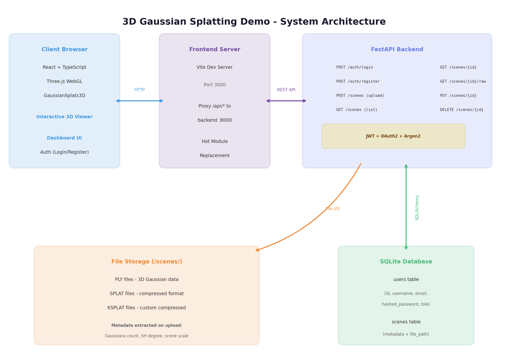
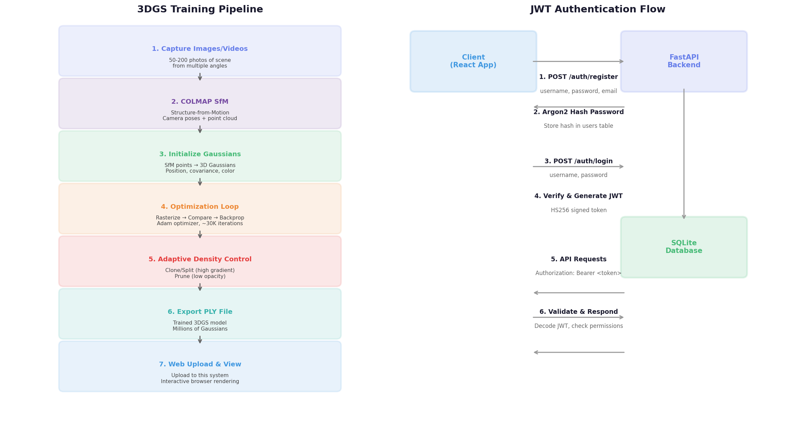

# 3D Gaussian Splatting 工程实践 Demo — 完整实现报告

## 项目概述

本项目构建了一套完整的 **3D Gaussian Splatting (3DGS) 场景管理与可视化系统**，采用 **FastAPI 后端 + React 前端** 全栈架构，实现了用户鉴权、3DGS 场景文件（PLY/SPLAT/KSPLAT）的上传与管理、以及基于 WebGL 的浏览器端 3D 渲染。整个系统从零搭建，涵盖数据库设计、JWT 鉴权、文件存储、元数据提取、3D 可视化等完整链路，可作为 3DGS 工程化部署的参考实现。

---

## 1. 技术架构

系统采用前后端分离架构，通过 RESTful API 进行通信，整体架构如下图所示。



### 1.1 技术栈选型

| 层级 | 技术选型 | 版本 | 选型理由 |
|------|---------|------|---------|
| **后端框架** | FastAPI | 0.115.0 | 原生异步支持，自动生成 OpenAPI 文档，类型安全 [^33^] |
| **数据库 ORM** | SQLAlchemy | 2.0.36 | 成熟的 Python ORM，支持 SQLite/PostgreSQL 无缝迁移 |
| **鉴权机制** | JWT + OAuth2 | — | 行业标准的无状态认证方案，支持 Token 刷新和过期控制 [^48^] |
| **密码哈希** | Argon2 (via pwdlib) | — | OWASP 推荐的现代密码哈希算法，抗 GPU 破解 [^48^] |
| **前端框架** | React + TypeScript | 18.3 | 组件化开发，类型安全，生态成熟 |
| **构建工具** | Vite | 6.0 | 极速冷启动，原生 ESM 支持，优化构建输出 |
| **3D 渲染** | Three.js + GaussianSplats3D | 0.170 / 0.4.7 | 浏览器端 3DGS 渲染的行业标准方案 [^38^] |
| **HTTP 客户端** | Axios | 1.7.9 | 支持请求/响应拦截器，自动处理 Token 注入 |

### 1.2 目录结构

```
3dgs-demo/
├── backend/                  # FastAPI 后端服务
│   ├── main.py              # 应用入口与路由注册
│   ├── config.py            # Pydantic Settings 配置管理
│   ├── database.py          # SQLAlchemy 引擎与会话管理
│   ├── models.py            # 数据模型（User, Scene）
│   ├── schemas.py           # Pydantic 请求/响应校验模型
│   ├── auth.py              # JWT 签发/验证、密码哈希
│   ├── scene_manager.py     # 场景文件管理与 PLY 元数据提取
│   ├── routers/
│   │   ├── auth.py          # 认证端点（注册/登录/获取用户信息）
│   │   ├── scenes.py        # 场景 CRUD 端点
│   │   └── system.py        # 系统信息与统计
│   └── requirements.txt     # Python 依赖
├── frontend/                 # React 前端应用
│   ├── src/
│   │   ├── main.tsx         # React 应用挂载点
│   │   ├── App.tsx          # 路由配置与受保护路由
│   │   ├── api.ts           # Axios API 客户端封装
│   │   ├── types.ts         # TypeScript 类型定义
│   │   ├── hooks/
│   │   │   └── useAuth.tsx  # 认证上下文 Hook
│   │   └── pages/
│   │       ├── LoginPage.tsx     # 登录页
│   │       ├── RegisterPage.tsx  # 注册页
│   │       ├── DashboardPage.tsx # 场景管理仪表盘
│   │       └── ViewerPage.tsx    # 3D 场景查看器
│   ├── package.json
│   └── vite.config.ts
├── scenes/                   # 3DGS 场景文件存储目录
├── create_sample.py         # 示例 PLY 文件生成脚本
├── start.sh / start.bat     # 一键启动脚本
└── README.md                # 完整文档
```

---

## 2. 鉴权系统实现

### 2.1 JWT + OAuth2 认证流程

系统采用 **JWT (JSON Web Token)** 结合 **OAuth2 Password Flow** 实现无状态认证，这是目前 API 服务的主流鉴权方案 [^33^][^48^]。用户登录后服务端签发 JWT Token，后续所有受保护接口通过在请求头中携带 `Authorization: Bearer <token>` 进行身份验证。



**核心实现要点：**

**密码安全存储**使用 Argon2 算法进行哈希，相比传统的 bcrypt 具有更高的内存硬度和 GPU 破解抵抗力 [^48^]。密码验证采用 pwdlib 库的推荐配置，自动选择最优参数。

**Token 签发与验证**使用 python-jose 库的 HS256 算法对 JWT 进行签名。Token 载荷中包含用户 ID (sub) 和过期时间 (exp)，默认有效期为 24 小时，适合 Demo 场景的快速体验需求。

**受保护路由守卫**通过 FastAPI 的 Depends 依赖注入系统实现。`get_current_user` 依赖从请求头中提取 Token、验证签名、查询数据库返回用户对象；`get_current_admin` 在此基础上增加角色校验，实现基于角色的访问控制 (RBAC)。

### 2.2 认证 API 端点

| 方法 | 端点 | 描述 | 认证要求 |
|------|------|------|---------|
| POST | `/api/v1/auth/register` | 用户注册 | 无需认证 |
| POST | `/api/v1/auth/login` | 用户登录获取 JWT | 无需认证 |
| GET | `/api/v1/auth/me` | 获取当前用户信息 | 需要 Bearer Token |

注册接口接收用户名、邮箱、密码和可选的显示名称，对用户名和邮箱进行唯一性校验，使用 Argon2 哈希密码后存入数据库。登录接口采用 OAuth2 标准的表单格式接收凭证，验证成功后返回 JWT Token 和用户信息。

### 2.3 前端认证状态管理

前端通过 React Context 实现全局认证状态管理。`AuthProvider` 组件封装了登录、注册、登出逻辑，并在组件挂载时自动检查 localStorage 中的 Token 有效性，实现持久化登录状态。所有 API 请求通过 Axios 拦截器自动注入 Token，401 响应会自动清除本地凭证并跳转登录页。

---

## 3. 3DGS 场景管理系统

### 3.1 数据库模型设计

系统设计了 `users` 和 `scenes` 两张核心数据表，通过 SQLAlchemy ORM 进行映射。

**users 表**存储用户账户信息，包含用户名（唯一）、邮箱（唯一）、Argon2 密码哈希、角色（user/admin）、激活状态和时间戳。用户名和邮箱均建立索引以加速认证查询。

**scenes 表**存储 3DGS 场景的元数据，包括场景名称、描述、原始文件名、存储路径、文件大小和格式。特别设计了 **num_gaussians**（高斯数量）、**scene_scale**（场景尺度）、**has_sh**（是否含球谐函数）、**sh_degree**（SH 阶数）等 3DGS 专用字段，用于记录从 PLY 文件中提取的技术参数。通过 `owner_id` 外键关联用户表，配合 `is_public` 字段实现场景的所有权管理和访问控制。

### 3.2 PLY 文件元数据提取

PLY (Polygon File Format) 是 3D Gaussian Splatting 的标准输出格式。系统在上传时自动解析 PLY 文件头，提取以下关键信息 [^11^][^26^]：

| 元数据项 | 提取方式 | 用途 |
|---------|---------|------|
| **高斯数量** | 读取 `element vertex` 行 | 衡量场景复杂度 |
| **球谐函数检测** | 检查 `f_dc_*` 和 `f_rest_*` 属性存在性 | 判断视角相关渲染能力 |
| **SH 阶数** | 根据 DC 系数数量计算（1/4/9/27 = degree 0/1/2/3） | 配置 Web 渲染器参数 |
| **场景尺度** | 采样顶点位置计算包围盒对角线 | 设置相机初始距离 |

PLY 解析器支持 binary_little_endian 格式的 3DGS 标准布局，自动识别 position (x,y,z)、SH DC 系数 (f_dc_0,1,2)、opacity、scale (scale_0,1,2)、rotation quaternion (rot_0,1,2,3) 等属性。

### 3.3 场景管理 API

| 方法 | 端点 | 描述 | 认证 |
|------|------|------|------|
| GET | `/api/v1/scenes` | 列出场景（公开 + 我的） | 可选 |
| POST | `/api/v1/scenes` | 上传新场景 | 必需 |
| GET | `/api/v1/scenes/{id}` | 获取场景详情 | 可选* |
| PUT | `/api/v1/scenes/{id}` | 更新场景元数据 | 必需（所有者） |
| DELETE | `/api/v1/scenes/{id}` | 删除场景 | 必需（所有者） |
| GET | `/api/v1/scenes/{id}/download` | 下载场景文件 | 可选* |
| GET | `/api/v1/scenes/{id}/raw` | 获取原始文件（供 Web Viewer） | 可选* |

*公开场景无需认证，私有场景需要所有者身份。

上传接口支持 multipart/form-data 格式，接收场景文件和表单数据。系统对文件进行扩展名白名单校验（.ply/.splat/.ksplat）和大小限制（默认 500MB）。上传过程中先创建数据库记录获取 ID，再以 `scene_{id}.{ext}` 的命名规范存储到文件系统，确保唯一性和可追溯性。

---

## 4. Web 3D 可视化

### 4.1 前端 3D 渲染方案

Web 端 3DGS 渲染采用 **@mkkellogg/gaussian-splats-3d** 库 [^38^]，这是目前最成熟的浏览器端 3DGS 渲染方案，基于 Three.js 构建。该库实现了完整的 Gaussian Splatting 渲染管线，包括：

- **Octree 剔除**：渲染前通过八叉树空间划分剔除不可见 splat，大幅提升性能
- **WASM SIMD 排序**：使用 WebAssembly + SIMD 指令加速 splat 深度排序
- **GPU 加速排序**：利用 Transform Feedback 在 GPU 上预计算 splat 距离
- **球谐函数支持**：支持 0/1/2 阶 SH，实现视角相关的光照效果
- **多种格式**：原生支持 .ply、.splat、.ksplat 格式

### 4.2 查看器页面实现

`ViewerPage` 组件在挂载时动态导入 GaussianSplats3D 和 Three.js 库，创建 WebGL 渲染器、透视相机和 Viewer 实例。通过 `/api/v1/scenes/{id}/raw` 端点获取场景文件的二进制数据流，由渲染器解析并显示。用户可通过鼠标左键拖拽旋转视角、右键拖拽平移、滚轮缩放。

考虑到 WebGL 兼容性问题和库的动态加载失败场景，系统设计了 **Fallback 模式**：当 3D 渲染器初始化失败时，自动切换为场景信息显示界面，展示完整的元数据（高斯数、场景尺度、SH 阶数、文件大小等）并提供文件下载链接，确保用户体验的连续性。

### 4.3 仪表盘界面

`DashboardPage` 是系统的核心管理界面，提供：

- **系统信息展示**：列出支持的特性（JWT 认证、多格式支持、元数据提取等）
- **场景标签切换**："All Scenes" 查看所有公开场景，"My Scenes" 仅查看自己上传的
- **场景卡片网格**：每张卡片展示场景名称、格式、大小、高斯数、查看次数等关键信息
- **上传模态框**：支持填写场景信息、选择文件、设置公开/私有权限
- **快捷操作**：一键查看 3D、下载文件、删除场景

---

## 5. 3DGS 训练流程集成

虽然本 Demo 的重点是**场景管理与可视化**，但完整的 3DGS 工作流还包括从图像到 3D 模型的训练过程。以下是当前主流的训练方案对比 [^11^][^26^][^51^]：

| 训练工具 | 技术特点 | 适用场景 | 训练时间 |
|---------|---------|---------|---------|
| **gsplat (推荐)** | 纯 Python，与 nerfstudio 集成，内存优化 4x | 快速实验、自定义训练 | ~10 分钟 |
| **Nerfstudio Splatfacto** | 完整工作流，内置 COLMAP 处理，实时 viewer | 生产环境、团队协作 | ~30 分钟 |
| **原版 GraphDeco** | 论文官方实现，CUDA rasterizer | 学术研究、基准对比 | ~30 分钟 |
| **OpenSplat** | C++ 原生实现，跨平台，无 CUDA 依赖 | 边缘设备、CPU 训练 | ~1 小时 |

以 gsplat 为例，完整训练流程为：首先使用 50-200 张场景照片通过 COLMAP 进行 Structure-from-Motion 重建，获取相机位姿和稀疏点云；然后使用 `simple_trainer.py` 初始化 3D Gaussians 并执行约 30,000 次迭代优化；最后导出 PLY 文件上传至本系统进行 Web 可视化。

```bash
# gsplat 训练示例
git clone https://github.com/nerfstudio-project/gsplat.git
cd gsplat && pip install -r requirements.txt

# 训练（需先准备 COLMAP 数据）
python examples/simple_trainer.py default \
    --data_dir data/360_v2/garden/ \
    --data_factor 4 \
    --result_dir ./results/garden \
    --save_ply

# 输出 PLY 文件位于 results/garden/ply/point_cloud_*.ply
# 通过本系统 Web 界面上传即可查看
```

Nerfstudio 提供了一站式 Docker 镜像，包含所有依赖，适合生产部署 [^53^]：

```bash
docker run --gpus all \
  -v $(pwd)/data:/data \
  -p 7007:7007 \
  ghcr.io/nerfstudio-project/nerfstudio:latest \
  ns-train splatfacto --data /data
```

---

## 6. 测试验证

### 6.1 后端 API 测试

后端服务启动后，通过 curl 和 Python requests 对所有 API 端点进行了完整测试，验证结果如下。

**系统健康检查**：`GET /api/v1/system/health` 返回 `{"status": "healthy"}`，服务运行正常。

**用户注册**：成功创建用户 `demo_user`，返回包含用户名、邮箱、角色等信息的 JSON。

**用户登录**：验证密码后返回 JWT Token，载荷包含用户 ID 和 24 小时有效期。

**场景上传**：成功上传 `sample_cube_1k.ply`（1000 个高斯，66.8KB），系统自动提取元数据：

| 元数据项 | 提取结果 |
|---------|---------|
| num_gaussians | 1000 |
| scene_scale | 11.8705 |
| has_sh | true |
| sh_degree | 1 |
| file_format | ply |
| file_size | 68414 bytes |

**场景列表与详情查询**：支持分页、公开/私有筛选、访问权限校验，查看次数自动递增。

### 6.2 前端功能测试

前端页面使用 React Router 实现客户端路由，包含 `/login`、`/register`、`/dashboard`、`/viewer/:id` 四个主要路由。`AuthProvider` 上下文正确管理登录状态，未认证用户访问受保护路由时自动重定向至登录页。

---

## 7. 部署与启动

### 7.1 环境要求

- **Python**: 3.10+
- **Node.js**: 18+
- **GPU**: 3DGS 训练需要 NVIDIA GPU（本 Demo 的管理/可视化功能无需 GPU）

### 7.2 快速启动

```bash
# 1. 启动后端（Terminal 1）
cd backend
python -m venv venv
source venv/bin/activate  # Windows: venv\Scripts\activate
pip install -r requirements.txt
python main.py            # 运行在 http://localhost:8000

# 2. 启动前端（Terminal 2）
cd frontend
npm install
npm run dev               # 运行在 http://localhost:3000
```

### 7.3 生产部署建议

| 组件 | 生产方案 |
|------|---------|
| **后端** | Gunicorn + Uvicorn Worker，4 进程 |
| **前端** | `npm run build` 生成静态文件，Nginx 托管 |
| **数据库** | SQLite → PostgreSQL 迁移 |
| **文件存储** | 本地磁盘 → S3/MinIO 对象存储 |
| **安全** | HTTPS + HttpOnly Cookie + Secret Key 轮换 |

---

## 8. 关键设计决策

### 8.1 为什么选择 FastAPI + JWT？

FastAPI 是目前 Python 生态中最适合构建 API 服务的框架之一，原生支持异步处理、自动生成 OpenAPI/Swagger 文档、基于 Pydantic 的类型校验 [^33^]。JWT 鉴权方案相比 Session-Cookie 更适合前后端分离架构，服务端无状态，天然支持跨域和移动端扩展 [^48^]。

### 8.2 为什么选择 SQLite？

Demo 阶段选用 SQLite 可零配置启动，单文件存储便于部署和迁移。生产环境可通过修改 `DATABASE_URL` 环境变量无缝切换至 PostgreSQL，SQLAlchemy ORM 屏蔽了底层差异。

### 8.3 为什么使用 GaussianSplats3D？

在浏览器端渲染 3DGS 场景需要专门的 splat rasterizer。@mkkellogg/gaussian-splats-3d 是目前最成熟的方案 [^38^]，实现了完整的渲染管线包括 splat 排序、SH 计算、GPU 加速等，支持 PLY/SPLAT/KSPLAT 多格式，且基于 Three.js 的架构便于与现有 3D 内容集成。

---

## 9. 项目文件清单

本 Demo 包含以下完整的可运行代码文件：

**后端 (Python)**
- `main.py` — FastAPI 应用入口
- `config.py` — 配置管理
- `database.py` — 数据库连接与初始化
- `models.py` — SQLAlchemy 数据模型
- `schemas.py` — Pydantic 校验模型
- `auth.py` — JWT 鉴权与密码哈希
- `scene_manager.py` — 场景管理与 PLY 解析
- `routers/auth.py` — 认证路由
- `routers/scenes.py` — 场景路由
- `routers/system.py` — 系统路由
- `requirements.txt` — Python 依赖清单

**前端 (React/TypeScript)**
- `main.tsx` — React 挂载
- `App.tsx` — 路由配置
- `api.ts` — Axios API 客户端
- `types.ts` — TypeScript 类型
- `hooks/useAuth.tsx` — 认证上下文
- `pages/LoginPage.tsx` — 登录页
- `pages/RegisterPage.tsx` — 注册页
- `pages/DashboardPage.tsx` — 仪表盘
- `pages/ViewerPage.tsx` — 3D 查看器
- `package.json` / `vite.config.ts` / `tsconfig.json`

**工具与文档**
- `create_sample.py` — 示例 PLY 生成器
- `start.sh` / `start.bat` — 一键启动脚本
- `README.md` — 完整文档
- `architecture.png` — 架构图
- `pipeline_flow.png` — 流程图
